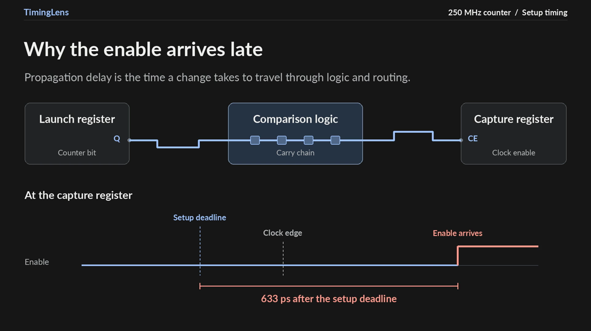
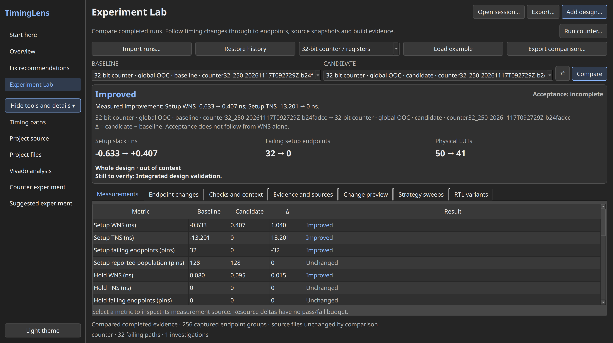
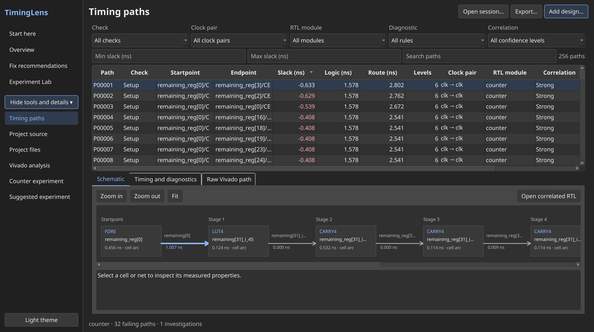

# TimingLens

TimingLens helps FPGA engineers find which signal missed a clock deadline, trace it back to the design, and test a fix. It reads AMD Vivado timing data and compares the original and revised designs after routing. The desktop shows which paths improved, which functional checks passed, and whether another path got worse. [Watch the 2:45 demo](#worked-example-of-a-250-mhz-countdown-timer) · [Explore the timing-closure techniques](docs/timing-closure-techniques.md)

**[Follow the step-by-step tutorial](tutorial.md)** · [Illustrated user guide](docs/visual-guide.md) · **[Browse the examples with screenshots](examples/README.md)**

## Why a design can miss timing

At 250 MHz, rising clock edges are only **4 ns apart**. When one register launches a new value, the signal takes time to travel through logic cells and the wires between them. That travel time is **propagation delay**. The receiving register needs the data or control signal to settle *before* its capture edge (setup) and stay stable briefly *after* it (hold). For setup, **slack** is the time left between arrival and the setup deadline. Negative slack means the signal arrived late.

A long chain of comparisons or multiplies can use up the budget in logic. Even a simple enable can arrive late if it drives hundreds of loads over long routes. TimingLens shows how much delay Vivado attributed to each part of the path, so an engineer can decide whether to simplify the logic, redistribute work across clock cycles, or try a different physical implementation.

## Worked example of a 250 MHz countdown timer

The demo opens with a propagation-delay animation. At **0:22**, the TimingLens GUI follows a slow wire to the RTL and shows which logic, routing, and resource changes an engineer can try. At **1:17**, a 250 MHz countdown timer misses setup at its clock enable by **633 ps**. The RTL diff and two circuit diagrams show how changing the comparison clears all **32 failing setup endpoints**.

**[Watch the demo on mobile](https://rlongwell.github.io/TimingLens-public/)**

[Download the demo](media/demo-v17/TimingLens-propagation-to-closure.mp4) · [English captions](media/demo-v17/TimingLens-propagation-to-closure.srt)

The 32-bit timer subtracts an accepted four-bit request when enough count remains. The request is at most 15. If any count bit above bit 3 is set, the count is at least 16 and the request always fits. Otherwise, only the low four bits need comparing. TimingLens previews that change and keeps the subtraction on the original clock edge.

| Standalone timer, same 4 ns clock | Original | Revised |
| --- | ---: | ---: |
| Worst setup slack | −0.633 ns | +0.407 ns |
| Failing setup endpoints | 32 | 0 |
| Physical lookup tables | 50 | 41 |

Both versions passed the same **10,289-cycle** simulation. The revised standalone timer also passed routed setup and hold. Timing in a larger design needs its own routed check. [Timer RTL](examples/counter32_250/design.sv) · [Run details and validation scope](docs/counter-runner.md#250-mhz-closure-example)

**Try it.** Run `./dashboard.sh` and choose **Start here → Review counter experiment**. Preview the RTL diff and select **Validate and run experiment** to simulate and route both versions. [CLI commands and offline review](docs/usage.md)

## What you can do with TimingLens

- **Inspect a routed path.** Open a Vivado project or checkpoint, import text reports, or reopen a saved session offline. See the launch and capture pins, the logic and nets between them, and where each delay accumulated. Jump to the matching HDL when Vivado retained source information.
- **Find a shared cause.** Group failing endpoints by common logic or control signals. Inspect evidence for a deep logic chain, a slow high-fanout branch, or a constraint that needs review. Cross-check the graph against the original timing report.
- **Try a targeted change.** Preview a counter rewrite, compare three ways to implement a priority selector, or try Vivado placement and routing strategies. The bundled experiments isolate baseline and candidate builds, run functional checks, and compare the results under the same clock constraint.
- **Review the tradeoffs.** Experiment Lab tracks setup, hold, endpoint regressions, resource use and validation results. Export the comparison to HTML or JSON, or use the CLI and Python API for repeatable analysis.

## Timing-closure techniques

The [technique guide](docs/timing-closure-techniques.md) explains how each change works, when it applies, and what happened after routing. Alongside the counter, priority-mux and Vivado strategy experiments, TimingLens can redistribute arithmetic across existing pipeline stages, move supported multipliers between lookup tables and DSPs, and move supported memories between block RAM and distributed RAM. In one 125 MHz pipeline, redistributing the work across four existing cycles cleared **1,872 failing endpoints** while preserving the four-cycle interface. [Try an automatic fix in a project copy](docs/automatic-fixes.md) · [Run the dense-design examples](examples/dense-suite/README.md)

## Platform and tools

The desktop and offline viewer run on **Ubuntu 24.04 LTS x86-64** with **Python 3.11+**, `python3-venv` and PySide6. Fresh builds use **AMD Vivado 2024.2** with Zynq-7000 device support. The timer uses Verilator 5.020, and the priority-mux equivalence checks use Yosys 0.69. The examples target the Zybo Z7-20 device model and run on the PC. [Setup and usage](docs/usage.md) · [Tool architecture](docs/architecture.md) · [Validation environment](docs/validation.md)
