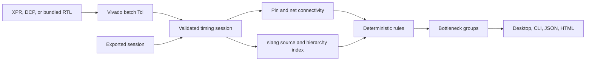

# Architecture



- `vivado/` owns executable discovery, batch process orchestration, read-only design access, and the Tcl transport. The decoder joins matching timing report rows to native objects.
- `timing/` owns the versioned Pydantic records, interchange validation, and atomic file serialization.
- `netlist/` owns directional pin connectivity, cone traversal, shared objects, and contiguous path segments.
- `rtl/` owns the slang syntax index and evidence levels. The index records module declarations, instances, and selected RTL constructs and identifiers.
- `rules/` defines fixed diagnostic metadata, validated thresholds, and deterministic predicates. `analysis/` selects path associations and forms ranked bottleneck groups.
- `service.py` connects import, live collection, diagnosis, and exporting. The Qt shell loads live or imported sessions in a worker thread and retains the previous session when a job fails.

## Vivado evidence

Setup and hold collection use `get_timing_paths` with separate max and min checks. Timing-path objects provide endpoints, clocks, slack, requirement, arrival, required time, datapath components, skew, uncertainty, and levels when the property exists. `get_cells`, `get_pins`, and `get_nets` return ordered datapath objects. Native relationships give cell owners and net drivers and loads. The collector groups net segments with Vivado’s own hierarchical net commands. It never joins nets based on textual resemblance. The first path’s `report_property -all` is retained for inspection. [Vivado Tcl command reference](https://docs.amd.com/r/2024.2-English/ug835-vivado-tcl-commands), [Timing path object properties](https://docs.amd.com/r/2024.2-English/ug912-vivado-properties/TIMING_PATH), [Ordered datapath objects](https://docs.amd.com/r/en-US/ug894-vivado-tcl-scripting/Timing-Path-Object).

DFX timing tables are parsed using their header column positions, including the extra Partition and PBlock fields. Per-sink net delay and per-arc cell delay come from `report_timing -of_objects`. A delay is attached only when ordered pins and, for a net, the resource label agree with the graph. The collector keeps other parts of the report as text. Design-wide setup and hold totals come from the Design Timing Summary section of `report_timing_summary`. `report_design_analysis`, `report_clock_interaction`, `check_timing`, and `report_route_status` provide additional evidence and stage information. Raw reports remain available in the desktop and export. [Timing report options](https://docs.amd.com/r/2024.2-English/ug835-vivado-tcl-commands/report_timing), [Design analysis](https://docs.amd.com/r/2024.2-English/ug835-vivado-tcl-commands/report_design_analysis), [Constraint checks](https://docs.amd.com/r/2024.2-English/ug835-vivado-tcl-commands/check_timing).

Project reads use `open_project -read_only` and `open_run`. Existing checkpoints use `open_checkpoint`. Requested builds launch Vivado runs only in a `save_project_as -exclude_run_results` copy. The copy disables external IP cache writes and rejects run hooks that could reach back into the original project. The batch process uses a unique output folder and a Linux process group for cancellation. For projects that depend on custom build hooks or unsupported project-copy behavior, build in the established Vivado workflow and open its completed run or DCP. [Vivado project and checkpoint commands](https://docs.amd.com/r/2024.2-English/ug835-vivado-tcl-commands/Tcl-Commands-Listed-by-Category), [Vivado IP cache controls](https://docs.amd.com/r/2024.2-English/ug835-vivado-tcl-commands/config_ip_cache).

## Source attribution

| Confidence | Required evidence |
| --- | --- |
| Vivado source tag | The cell exposes `FILE_NAME` and `LINE_NUMBER`, the file is available, and the location falls within one parsed module. This is an origin hint, not proof of an exact critical expression. Optimization can combine or move RTL from multiple lines into that cell. Path-level navigation selects a module, never one cell’s line as the cause of a whole path. |
| Strong | A surviving Vivado hierarchy cell and original reference agree with a parsed instance declaration in its parent module. |
| Partial | Vivado identifies the module or design top. The source expression cannot be established. |
| Unknown | Cell source properties and usable hierarchy are absent or ambiguous. |

Vivado 2024.2 exposed `FILE_NAME`, `LINE_NUMBER`, `PARENT`, and `ORIG_REF_NAME` on cells in the local probes. Availability is checked for every object. A stale project run or source timestamp newer than a standalone checkpoint suppresses direct attribution. A checkpoint does not provide a source revision digest for independent verification of the original file's contents. The digest in the session verifies the bytes seen by TimingLens. [Vivado synthesized-design cross-probing](https://docs.amd.com/r/2024.2-English/ug892-vivado-design-flows-overview/Opening-a-Synthesized-Design).

The syntax index parses captured files independently. The semantic review layer then elaborates the supplied top using pyslang 9.1.0, including parameter values, hierarchy and generate instances. `rtl/semantics.py` records expression byte spans, elaborated widths/signedness/state type, dependencies, clocked updates and branch/hold decisions. It was present before this upgrade and is now connected to the recommendations. Unsupported cases, loops in writers, asynchronous event lists, multiple writers, partial updates and missing compile context suppress the narrow rewrite. A parameter-free module can be reviewed in isolation, explicitly without claiming full project elaboration.

The worker in `rtl/bounded.py` / `rtl/semantic_worker.py` receives JSON data through stdin; supplied HDL/Tcl is never run as a command. It has a 6-second wall timeout, 4-second soft CPU budget, 512 MiB address-space cap, and limits on bytes, targets, recursion, instances and generation. Large projects can fall back to target files for isolated-module hypotheses; they cannot receive a full-project diff. Ambient include lookup is disabled. Supplied inline macros can parse, but expansions cannot become exact edit spans. Vivado global macros/include settings, generated files not supplied, and VHDL elaboration remain unavailable. Missing detail produces a reason, not an invented source cause.

## Diagnostic rules and grouping

| Rule | Detection |
| --- | --- |
| TL-A | Negative setup slack, at least 8 Vivado levels, at least 0.8 ns logic, and logic at least 30% of the requirement. |
| TL-B | At least 3 connected mux data arcs with source tags overlapping a priority construct; semantic equivalence must be checked. LUT3 INIT truth tables and MUXF pins establish the mux roles. |
| TL-C | A failing setup path has a non-clock net with at least 64 loads, a branch delay of at least 0.45 ns, and branch delay at least 12% of the datapath. |
| TL-D | At least two captured nets and at least 60% of the failing setup datapath spent in routing. |
| TL-E | A failing setup path has at least three connected carry primitives or DSP arcs contribute at least 20% of the data delay. |
| TL-F | Vivado reports a dedicated RAM primitive on the failing setup datapath. |
| TL-G | Authoritative timing-check counts or a matching suspicious timed clock-pair classification. |
| TL-H | Measured negative slack with no supported diagnosis. |

The defaults live in `Thresholds`. All changes are opt-in recommendations, with tradeoffs and verification criteria. The engineer controls all RTL and constraint edits.

Each finding has graph or report anchors. Paths with the same rule and check type join only on a shared eligible anchor. For multi-anchor findings the most recurrent anchor wins, with ordered path evidence as the deterministic tie-break. Distinct rules can overlap the same path. A group counts unique path IDs and endpoint pins. Design-wide TNS and failing endpoint counts are read directly from Vivado.

### Relative score

```text
abs(worst_slack) × (1 + log2(max(1, affected_endpoints)))
                 × (1 + max_attributed_delay_fraction)
                 × (1 + 0.1 × source_confidence)
```

Confidence ranges from 0 to 3. A design-only constraint finding has no measured slack and scores zero. This score continues to order raw diagnostic groups. The review layer combines groups with identical path sets. It also combines arithmetic paths independently matched to the same generated source edit. It deduplicates candidate plans and orders actionable investigations first, then by `abs(negative slack) × (1 + log2(endpoint count))`, complete-path coverage and source specificity. Unexplained severe paths remain visible. Neither score estimates timing improvement.

## Scope

The graph is a captured slice, with native datapaths and off-path load pins for incident nets. Dedicated clock-tree cells, the entire placed design, and unrelated timing arcs are outside this capture. Partial pin evidence remains visible. The application retains load counts while limiting off-path sink details to 128 pins per net. DSP and block RAM detectors have unit coverage. Routed example coverage focuses on the four specified fixture designs.

## Detailed evidence coverage

CLI, HTML, diagnostics JSON, and the dashboard show measured arc counts and captured consecutive pin links separately from design-wide slack totals. Incomplete detail raises a prominent warning: an unknown delay is not zero and cannot support a slowest-branch claim. Individual paths retain the raw Vivado report. Import re-joins embedded raw timing rows against the captured native graph so older sessions with the DFX parser defect can be inspected without rerunning Vivado. No timing totals or original report text are changed.

A real routed Zybo DFX regression covers static, boundary, and reconfigurable report rows, wrapped carry delays, and a critical sink omitted from the capped fanout snapshot. Tests verify the actual delays and recovered graph continuity. Source tags and module associations are shown separately; neither proves the RTL edit needed for closure.

## Project-aware fix candidates

`inputs.py` merges explicitly chosen files with one authoritative session or report set. `vivado/text_import.py` builds a report-derived graph from printed resource rows; its reduced provenance is explicit. `project.py` extracts literal BD connections, IP parameters, build directives and XDC statements without executing Tcl. Optional versioned JSON stores user-declared buffer/clock/multicycle intent. Conflicting report metadata is rejected; changed captured source hashes suppress direct RTL hypotheses.

`analysis/fixes.py` gates exact Vivado experiment recipes by release, device, stage and detailed evidence. `analysis/rtl_fixes.py` requires contiguous carry connectivity to sequential CE, surviving register identity, unique source mapping and a semantic comparison/hold guard. It separates exact syntax, elaborated signal/type association, measured graph facts and inferred causality. Four-state comparisons receive no patch because Boolean factoring can change X propagation. `analysis/project_fixes.py` checks literal interface and scalar clock/reset nets, captured clock sources and measured cross-instance branch delays. These plans remain separate from measured timing findings.

Every plan records kind, scope, rule/version, evidence IDs and levels, path/object/location links, applicability, unknowns, action, prerequisites, checks and limits. Preview records add exact original/proposed text, UTF-8 byte offsets, source hash, status and optional unified diff. Diagnostics schema v2 adds investigations and source provenance while retaining raw findings/groups and legacy plan fields. The timing session schema is unchanged. Qt precomputes recommendations in its worker thread; rendering and selection do not trigger semantic compilation. No AI service, auto-editing, or timing-exception application is part of this engine.
