# How to use TimingLens

TimingLens takes a measured timing path from Vivado, shows the logic and wires that spent its clock budget, and lets you test whether a proposed change helps. You can explore a saved path immediately, run a small counter experiment, or collect timing from your own design.

[Step-by-step tutorial](../tutorial.md) · [Open your first path](#open-your-first-path) · [Add design evidence](#add-design-evidence) · [Trace a failure](#trace-a-failure) · [Review a fix](#review-a-fix) · [Run an experiment](#run-an-experiment) · [Compare and export](#compare-and-export) · [CLI and Python](#use-the-cli-and-python) · [Example walkthroughs](../examples/README.md)

## Open your first path

From the repository root on Ubuntu, use Python 3.11 or later with `python3-venv` installed. The launcher prepares the desktop environment on first use. This command opens a small, **real routed path included in the checkout**. You can follow it offline without installing Vivado.

```bash
./dashboard.sh tests/fixtures/zybo_dfx_path.json
```

Choose **Show tools and details → Timing paths**, select the setup row and open **Raw Vivado path**. Find the source, destination and clock requirement. This reduced capture comes from a reconfigurable hash design. It includes one path and its source context. The [fixture notes](../tests/fixtures/README.md) explain how it was reduced.

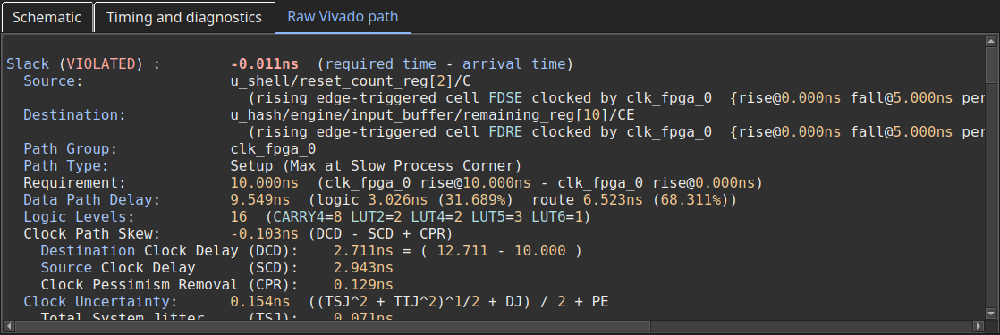

Launch `./dashboard.sh` without an argument to open **Start here**. **Choose design files…** stages new evidence. **Open saved analysis…** reopens a session. **Review counter experiment** previews the 250 MHz example before you run any build. **Return to current analysis** takes you back to an open design. The sidebar’s theme button switches between light and dark and saves your preference.

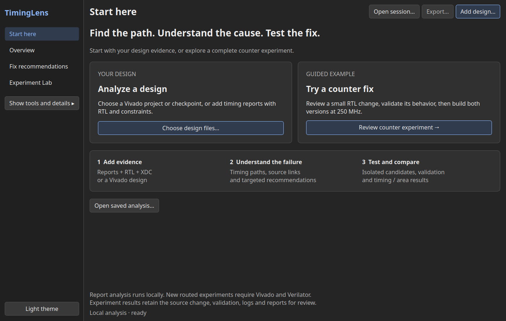

## Add design evidence

| Input you have | Where to open it | What you get |
| --- | --- | --- |
| Vivado project (`.xpr`) | **Add design… → Vivado analysis** | Inspect a completed run, build an isolated copy, or test a supported automatic fix. |
| Implemented or synthesized checkpoint (`.dcp`) | **Add design… → Vivado analysis** | Read the checkpoint with Vivado. Add matching source files for cross-probing. A synthesized design has estimated routing. |
| Text reports and project files | **Project files → Add files…**, or drag them onto the list | Combine one implementation’s timing summary and detailed paths with RTL, XDC and BD/build Tcl. The offline parser reads supplied text locally. |
| Saved `analysis.json` | **Open session…** | Reopen the timing summary, paths, graph and available source snapshots offline. |
| Before/after `.run.json` records | **Experiment Lab → Import runs…** | Compare completed builds, validation and physical results offline. |
| `sweep.json` or `rtl-sweep.json` with its run directory | **Experiment Lab → Strategy sweeps** or **RTL variants** | Reopen the recipes or variants, ranking, plot and associated evidence. |

**Capture from Vivado.** Choose one project or checkpoint, set the output directory and use **Run analysis**. For an XPR, **Inspect existing design** uses the current completed implementation when available, then a completed synthesis run. Enter a run name to select a specific one. The **Build** menu can synthesize or route an isolated project copy. Increase **Paths per analysis** and **Paths per endpoint** to investigate more branches. Clear **Include RTL snapshots** when source text should stay out of the exported JSON. The page shows progress, a live log and a cancel action. Use `./timinglens.sh doctor` to check Vivado discovery and device support. The documented builds use Vivado 2024.2 and the Zybo Z7-20 device model.

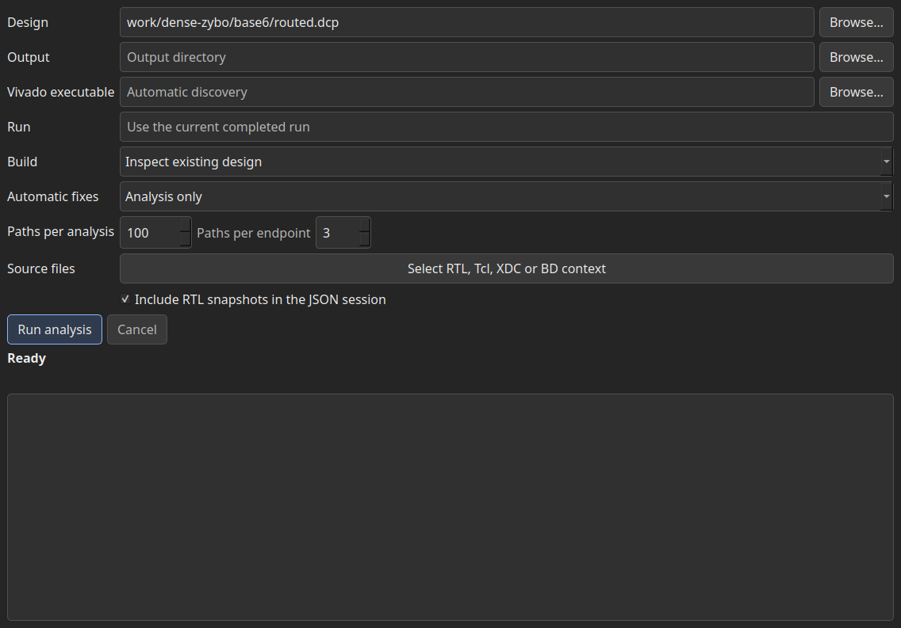

**Add offline context.** Supply a session or timing reports from one implementation. Add the matching Verilog/SystemVerilog, block design, XDC and optional design-intent JSON. Enter the RTL top when reconstructing hierarchy from text reports. With an analysis already open, enable **Use the current timing session with these additional files**, then **Analyze selected files**. A source revision mismatch limits direct source attribution. VHDL can be included as text context. [File formats and source matching](project-analysis.md)

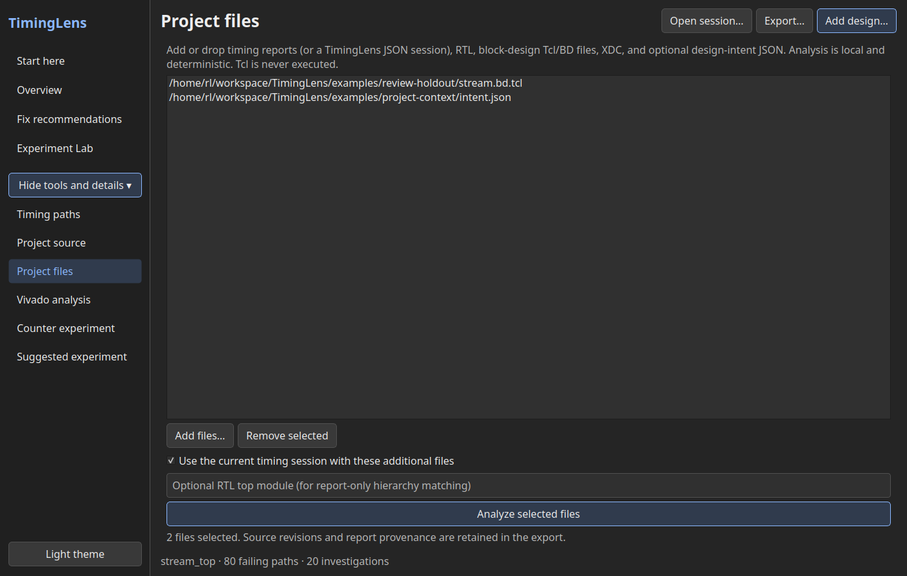

## Trace a failure

1. In **Overview**, read worst setup and hold slack, total negative slack (TNS) and failing endpoints. Negative setup slack means data arrived late. Negative hold slack means it changed too soon. **Collected failing paths** is the captured sample. The failing-endpoint card comes from Vivado’s design summary when supplied. The two counts can differ.
2. Inspect **Clock domains → Definitions** and **Interactions**. Check the clock period, generated clocks and relationships. Use **Available Vivado reports** for the native clock, constraint and timing evidence in that session. An incomplete path or a missing summary leaves a gap in what can be concluded.
3. Use **Review first issue** to open a group of related failures, or go straight to **Timing paths**. Filter by setup/hold, clock pair, RTL module, diagnostic or confidence. Set a slack range, search for a signal or endpoint, and sort the table. For a specific failure, note which launch pin feeds which capture pin.

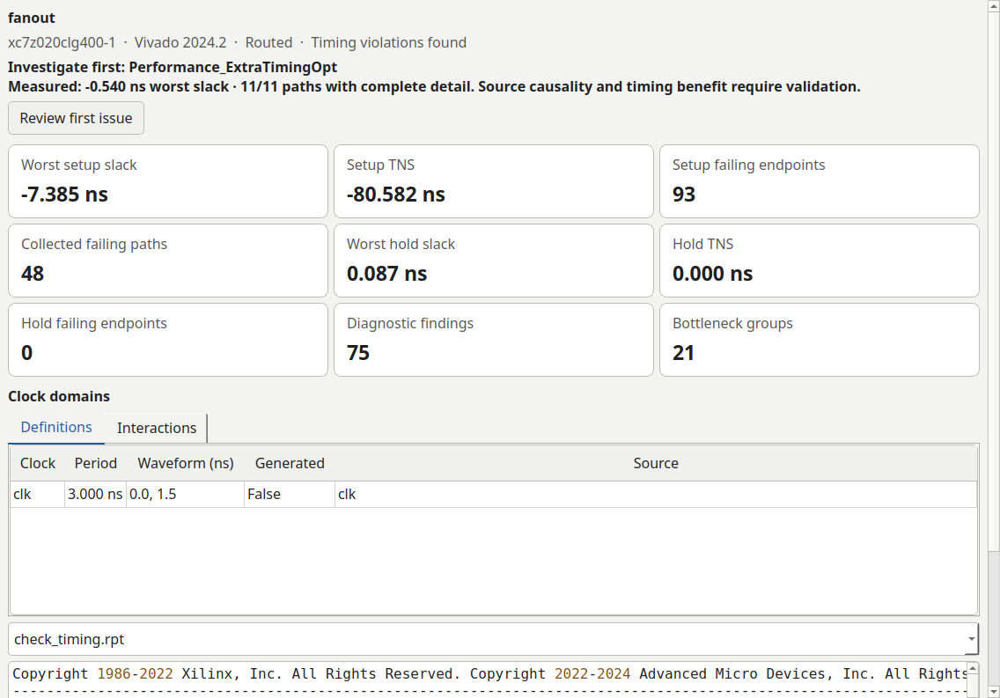

**Read a branch.** In the [high-fanout walkthrough](../examples/fanout/README.md), select the setup path to `lane[107].active_reg/CE` and click the control net in **Schematic**. A fanout of 192 says how many loads share the driver. The **2.404 ns** measured on this branch says why this particular endpoint matters. Use **Zoom in**, **Zoom out** or **Fit** to follow the path. **Timing and diagnostics** lists the logic/route split, skew, uncertainty, rule evidence and coverage. **Raw Vivado path** supplies the original text.

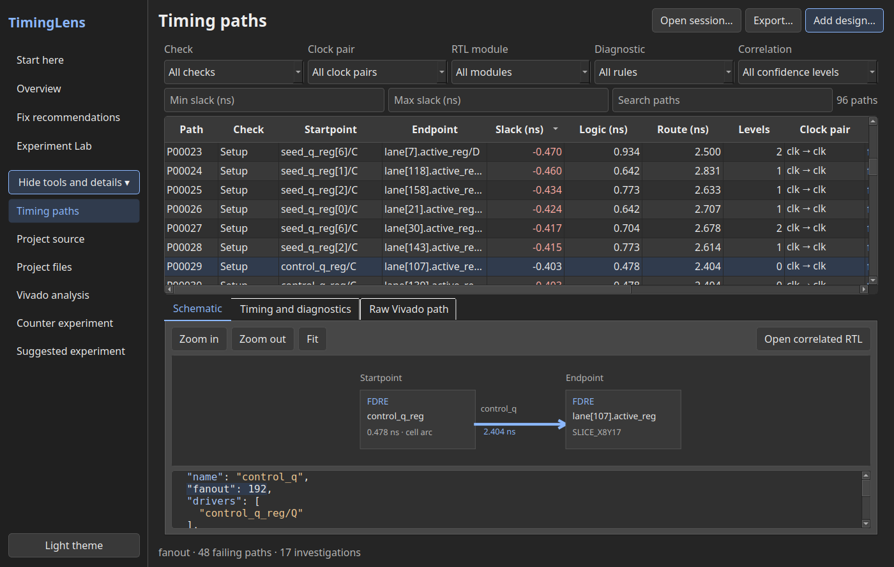

**Trace it to HDL.** Select a cell and choose **Open cell RTL**, or use **Open correlated RTL** for the path association. In **Project source**, the file selector, highlighted lines and **Find next** let you follow the signal through the module. Read the confidence and attribution above the editor. A source tag can point to the origin of optimized logic, while several expressions may contribute to the implemented cell.

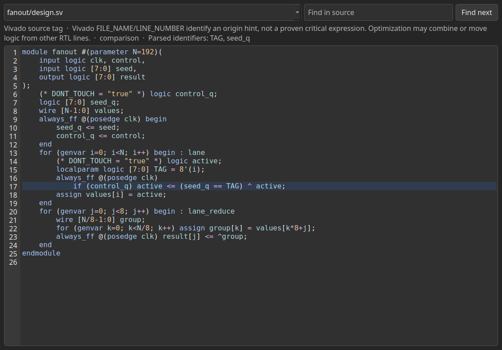

## Review a fix

In **Fix recommendations**, filter the issue tree by signal, rule or path. Expand a group to choose one endpoint. Use the candidate selector on the right to compare remedies for the same measured symptom.

| Tab | What to check |
| --- | --- |
| **Suggested change** | What the candidate changes, why it applies and the next engineering decision. |
| **Evidence** | Which facts came from a measured arc, parsed RTL, BD connection or supplied intent. Check the missing evidence too. |
| **Tcl & validation** | Required design stage, commands, validation and acceptance criteria. **Copy Tcl** copies the displayed recipe for review. |
| **Change preview** | Original and proposed expressions or a source diff when available. Use the alternatives selector and **Copy diff** for the expression you want to evaluate. |

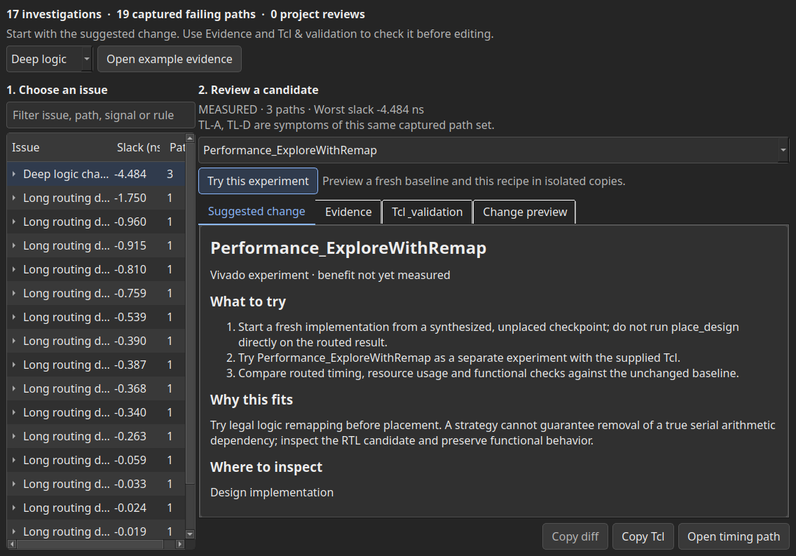

Choose the investigation that matches the cost on the path.

| Observed evidence | What to investigate |
| --- | --- |
| Connected logic, priority muxes or carry stages | Remap logic, test equivalent selection structures, or review the exact comparison driving an enable. Preserve priority, width, signedness and equality behavior. |
| Slow net with many loads, or a routing-dominated path | Inspect the specific sink branch and try an appropriate implementation recipe. |
| DSP arithmetic or RAM on a failing path | Check source ownership and existing pipeline stages, or try RAM placement. Any added latency needs an interface contract. |
| Stream boundary or backpressure | Locate the slow logic on the transmitting or receiving side. Verify ready/valid behavior, clock/reset domains and latency before evaluating a slice. Review FIFO capacity against actual burst and stall bounds. |
| Clock interaction, timing exception, or hold violation | Review XDC intent, ignored exceptions, coverage and CDC. Implementation-stage evidence can support a hold-fix experiment. Any proposed clock exception remains a commented template for engineering review. |
| Reconfigurable partition (DFX) | Keep static logic, partition pins and isolation fixed. Inspect the captured partition context and require the appropriate Vivado compatibility check before accepting an implementation. |

In the intent example below, a declared 256-beat burst exceeds the 16 beats of available buffering on the named link. The resulting FIFO review depends on those traffic assumptions. [Reproduce the intent example](../examples/project-context/README.md) · [Timing-closure techniques](timing-closure-techniques.md) · [Scope of RTL previews](semantic-review.md)

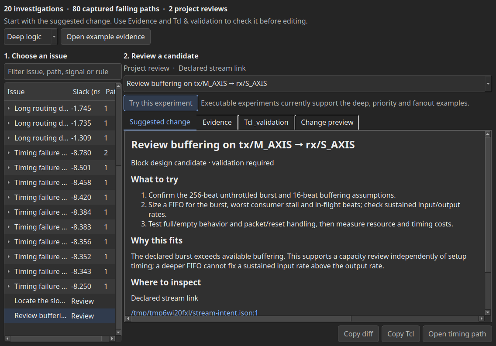

## Run an experiment

### Counter rewrite

Open **Start here → Review counter experiment**. In **RTL change**, check the complete guard. In **Validation and recipe**, check the clock, simulation scope and implementations. **Advanced settings** controls Vivado location, results folder and timeout. **Validate and run experiment** simulates both versions and routes fresh builds. Use **Live log** for progress, **Cancel** to stop the active job and **Open last job** to reopen saved evidence. The guided 250 MHz job opens the whole-core comparison. **Compare registers** selects the internal population. The two 2 ns profiles are available under **Counter experiment**. [250 MHz walkthrough](../examples/counter32_250/README.md)

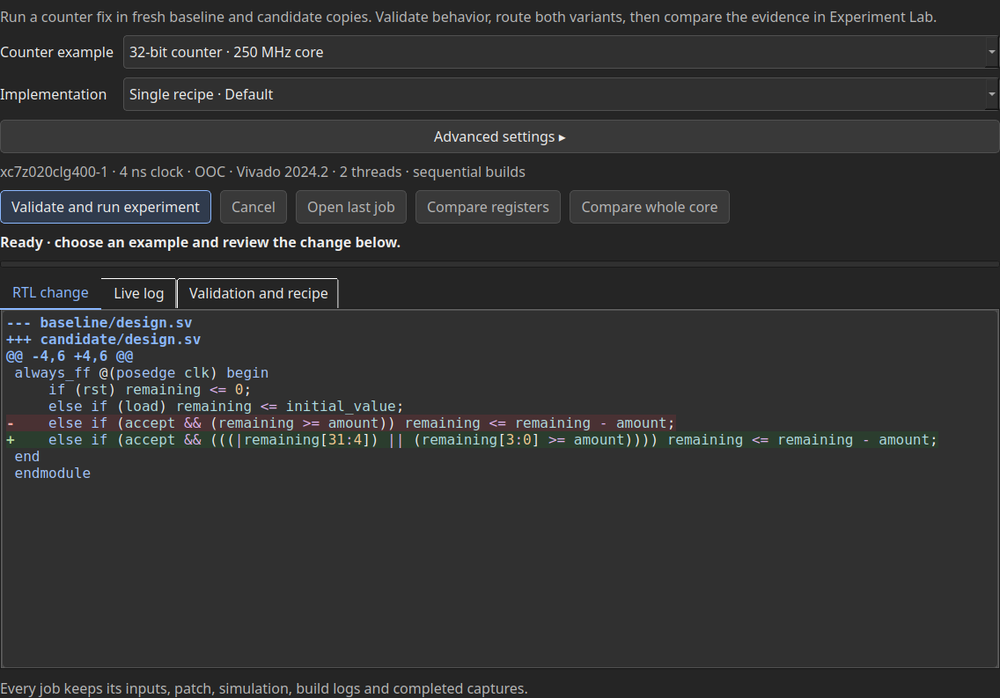

### Suggested implementation and RTL experiments

For the bundled deep, fanout or priority design, first generate the evidence using its example README. In **Fix recommendations**, select the example, **Open example evidence**, choose a supported candidate and select **Try this experiment**. Review the exact inputs, clock and recipe in **Suggested experiment** before **Run isolated experiment**. For priority RTL candidates, review the **Source diff** and keep the Yosys equivalence gate. The runner records stages and logs, supports cancellation and opens completed comparisons. **Compare design** shows the full example. [Supported recipes](recommendation-experiments.md) · [Balanced priority proof](priority-rewrite.md)

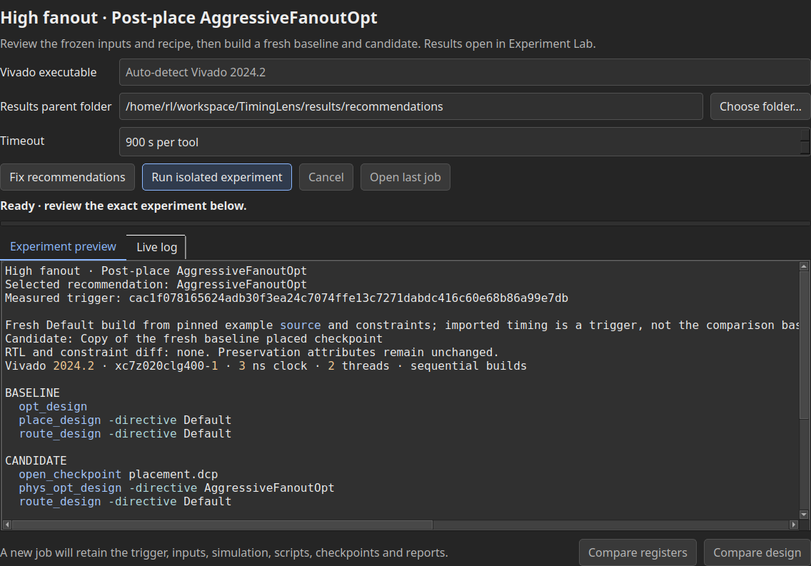

### Strategy and RTL sweeps

- In **Counter experiment**, select **Strategy sweep · 3 recipes**. Default, Performance_Explore and Performance_ExtraTimingOpt use the same factored candidate. In **Experiment Lab → Strategy sweeps**, select a row. Compare it with candidate Default to measure the recipe effect, or with original RTL to measure the combined effect. Switch between register and global results, read hold and endpoint changes, then export the sweep. [Strategy sweep walkthrough](../examples/counter64/README.md)
- For the priority example, select **Verified RTL variants · 3 candidates**. In **RTL variants**, click a row or plot point, set an optional LUT limit and choose the population. Read the timing/area tradeoff, proof and acceptance for each candidate. **Inspect selected comparison** opens the detailed pair. **Export sweep…** preserves the evidence for reopening. [Priority sweep walkthrough](../examples/priority/README.md)

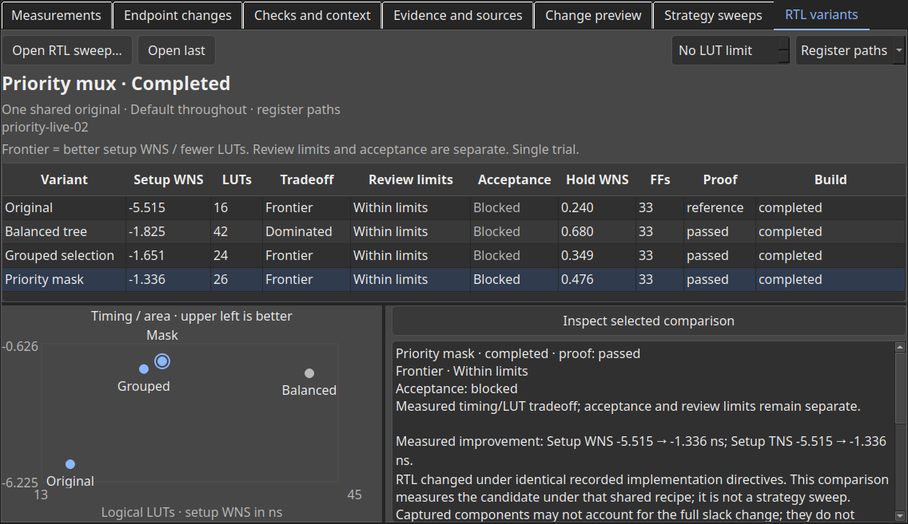

### Prove an arithmetic pipeline change

When failing DSP arcs map to a supported feed-forward RTL pipeline, **Fix recommendations → Change preview** shows how to use its existing cycles. Select **Verify RTL fix…** and choose an output parent. Yosys and Z3 compare the leaf’s output after pipeline fill for arbitrary binary inputs. The result folder holds both sources, the diff, proof and solver evidence. A routed design comparison and full-design simulation check physical timing and surrounding logic separately. [Calibration walkthrough](../examples/dense-zybo/README.md) · [Proof command and routed-pair check](usage.md#verify-an-arithmetic-pipeline-fix)

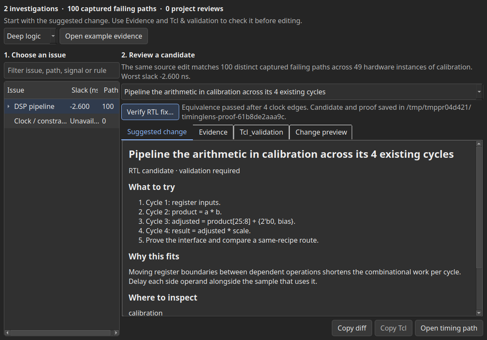

### Apply a verified project fix or rebalance resources

Open a self-contained static XPR with **Add design…**. Choose **Apply verified fixes in a project copy** to keep a separate candidate, or **Update the selected project after verification** to publish a passing edit to the source project and retain a backup. Then select **Run and apply verified fixes**. A supported multiplier recommendation also offers **Run from project…**. The runner builds the baseline, validates the change and routes the candidate under the same constraints. Supported edits include rescheduling arithmetic across existing registers and changing a compatible multiplier IP or memory mapping.

Enable **Rebalance overused resources** and enter a utilization limit when the objective is capacity. This can apply even to a design already meeting timing. Read the tradeoff in both resource pools, the proof or simulation, and any margin reductions or extra DRC warnings. The job’s `decision.json` records the disposition and paths to the project or comparison. [Automatic fix behavior](automatic-fixes.md) · [Seven resource workloads](../examples/resource-balance/README.md)

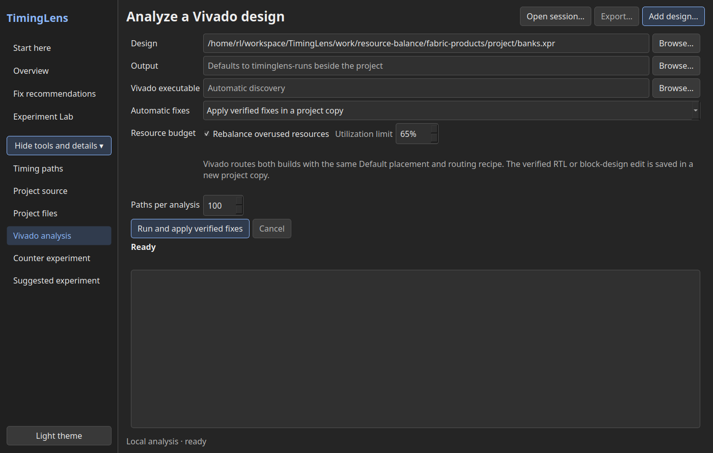

## Compare and export

Open **Experiment Lab → Import runs…**, select the two completed records, set **Baseline** and **Candidate** and choose **Compare**. The swap button reverses the direction. **Restore history** reopens previously imported files. **Load example** uses the retained counter/DFX catalog when available locally. On a fresh checkout, generate a pair with the counter runner, or import your own records.

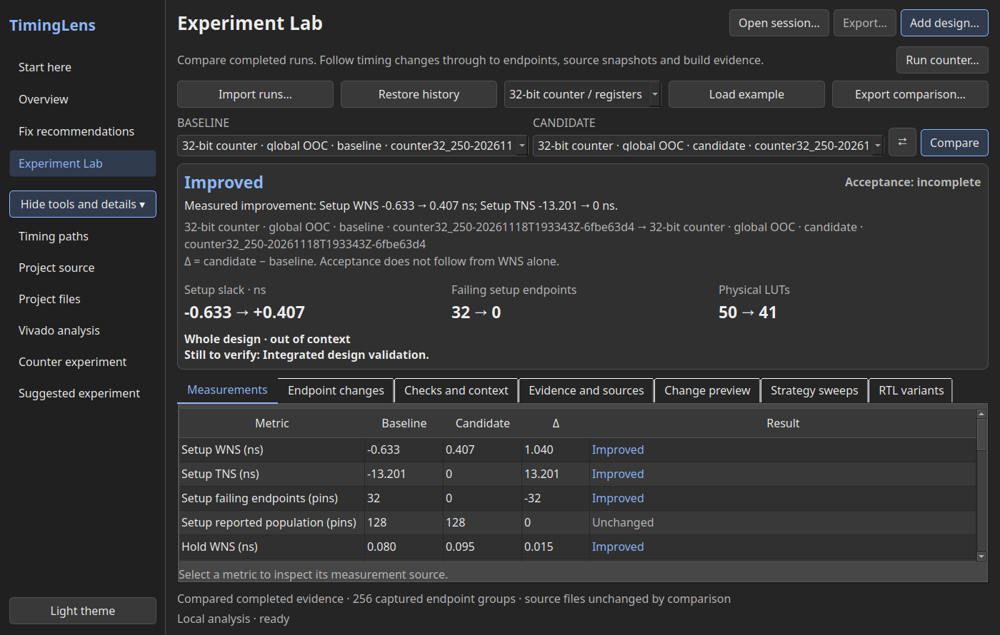

| Lab view | How to use it |
| --- | --- |
| **Measurements** | Select a metric to read its source. Compare WNS, TNS, endpoint counts, hold, pulse width, routing, DRC and area within the same population. |
| **Endpoint changes** | Search by pin or clock, or filter for regressions, newly failing or unmatched paths. Inspect either side’s embedded path. Matching uses endpoint/check/clocks. IDs such as P00001 belong to one capture. |
| **Checks and context** | Read the acceptance gates and build context. A better WNS can coexist with a regression. Missing validation stays **Not tested**. Check the clock, device, stage, constraints and scope. |
| **Evidence and sources** | Pick the baseline or candidate and open a retained report, source snapshot or validation record to audit the summary. |
| **Change preview** | Read the recorded edit alongside the routed results. |
| **Strategy sweeps / RTL variants** | Reopen or export a full sweep and drill into a candidate pair. |

The 64-bit counter illustrates why the endpoint view matters. Two previously passing data pins failed after a rewrite that improved worst setup slack. Select a row to read the baseline and candidate timing side by side.

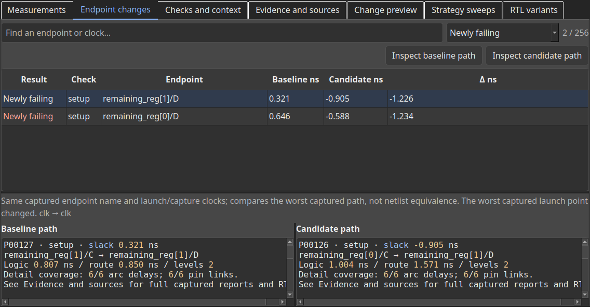

For the 250 MHz counter, the whole-core route passed. The acceptance record still marks integration into a larger design as untested. Select that gate or a report to see its scope.

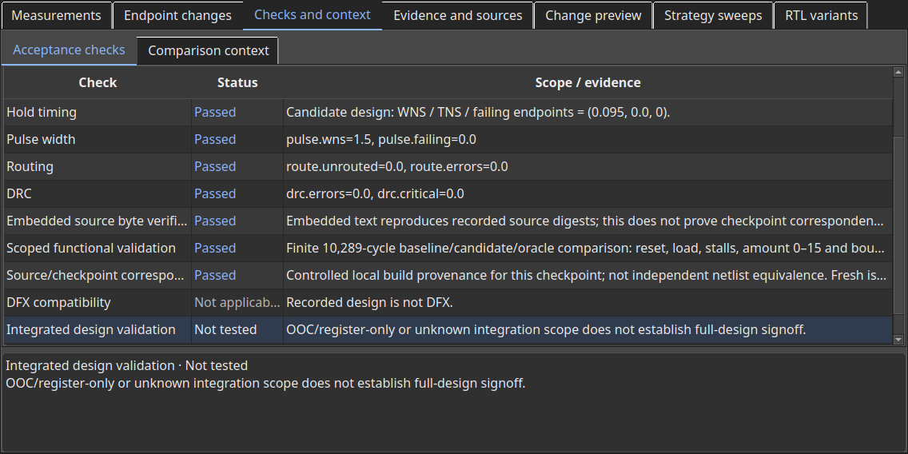

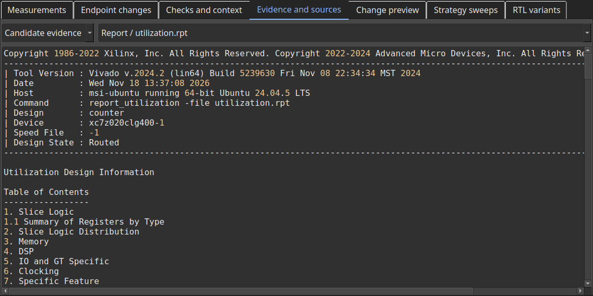

**Export…** in the main window saves the current analysis as `analysis.json`, `diagnostics.json` and `report.html`. **Export comparison…** in the Lab writes both portable run records, `comparison.json` and a standalone HTML comparison to a new folder. Open the HTML in a browser or reimport the two records to continue tracing endpoints offline. [Comparison rules and file contents](experiment-lab.md) · [Session schema](session-format.md)

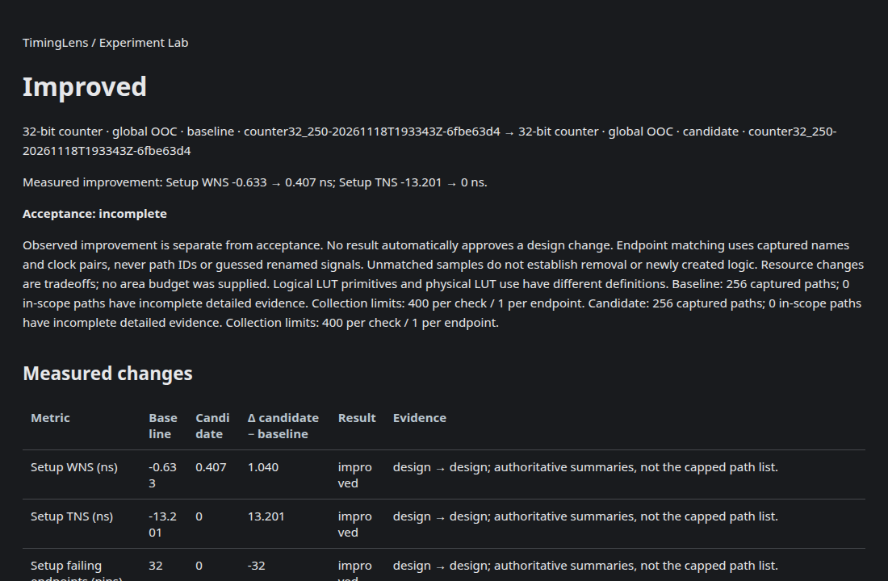

## Use the CLI and Python

Run these commands from the repository root. The first two use the saved hash path included in the checkout. Each command also accepts `--help`.

```bash
./timinglens.sh import --report tests/fixtures/zybo_dfx_path.json --output results/first-path
./timinglens.sh gui results/first-path/analysis.json
./timinglens.sh experiment --example counter32_250 --preview
```

| Command | Purpose |
| --- | --- |
| `doctor`, `gui` | Check the toolchain or launch the desktop with an optional saved session. |
| `analyze`, `demo` | Collect from a Vivado project/checkpoint or build the clean, deep, priority and fanout designs. Set maximum paths, paths per endpoint, source snapshots, build stage and Vivado executable. |
| `inspect`, `import` | Assemble reports plus context, or validate and reopen a saved session offline. Supply `--thresholds` on analysis/import workflows to override rule thresholds. On import, `--resolve-local-sources` enables hash-checked reads of referenced local files. |
| `experiment`, `try-experiment` | Preview or run a pinned counter recipe, strategy sweep or supported recommendation. |
| `verify-fix`, `auto-fix` | Prove a source-specific pipeline rewrite, or test and apply a supported project change. Use `--resource-limit` for resource balancing. |
| `compare` | Compare two self-contained records or native sessions and export results offline. |

The Python API exposes paths, groups and source associations for scripting. For example, list the rules and worst measured slack for groups found in the exported session.

```python
from pathlib import Path
from timinglens import analyze, read_session

result = analyze(read_session(Path("results/first-path/analysis.json")))
for group in result.groups:
    print(group.rule, group.anchor, group.worst_slack_ns)
```

[Command recipes and installation options](usage.md) · [Architecture and analysis rules](architecture.md) · [Example walkthroughs](../examples/README.md)
