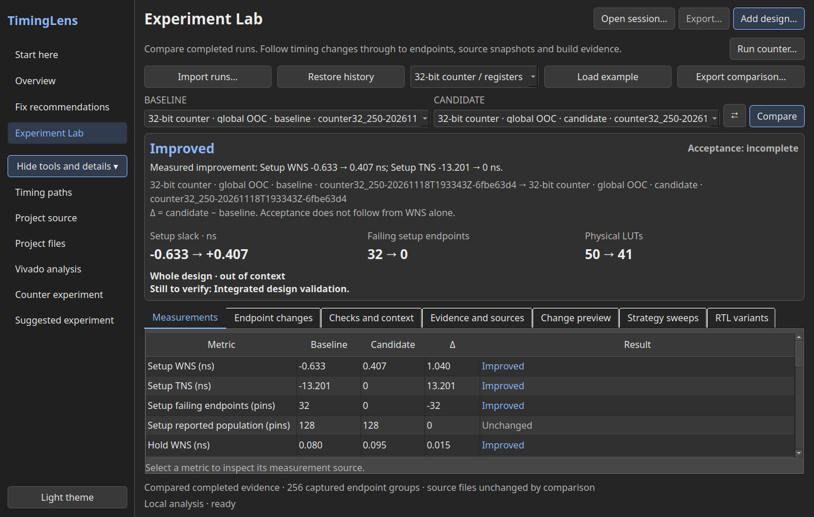

# TimingLens examples

Start with the **[250 MHz counter](counter32_250/README.md)** to follow one change from a failing enable through the RTL diff to a routed result. Start with **[high fanout](fanout/README.md)** to trace a measured delay from a physical wire back to its source. Each walkthrough includes screenshots from TimingLens and the inputs or commands needed to follow it.

## Choose an investigation

| Example | What to look for |
| --- | --- |
| [Clean datapath](clean/README.md) | Passing setup and hold with collected paths and zero findings. |
| [Deep logic](deep/README.md) | A 16-level register path and a Vivado remap that recovers only part of its timing margin. |
| [High fanout](fanout/README.md) | A single slow branch of a 192-load enable, an RTL cross-probe and a physical optimization trial. |
| [Priority selector](priority/README.md) | Three equivalent mux structures with different timing and LUT costs. |
| [32-bit counter at 2 ns](counter32/README.md) | A shorter comparison improves slack while 64 internal setup endpoints still fail. |
| [32-bit counter at 250 MHz](counter32_250/README.md) | The same logic change closes the standalone timer at a 4 ns target. |
| [64-bit counter at 2 ns](counter64/README.md) | Two newly failing data pins and a separate strategy sweep. |
| [Project context](project-context/README.md) | Match a design-intent file to a block-design link to review FIFO capacity or clock assumptions. |
| [Review holdout](review-holdout/README.md) | Examine a streaming receiver and a RAM/DSP datapath before committing to a latency change. |
| [Telemetry block design](telemetry-bd/README.md) | Distinguish arithmetic, priority and backpressure paths across a routed 25-block design. |
| [Dense Zybo calibration](dense-zybo/README.md) | Compare the [original](dense-zybo/original/README.md) and [revised](dense-zybo/revised/README.md) four-cycle implementations across 104 lanes. |
| [Dense benchmark suite](dense-suite/README.md) | Work through [I/Q power](dense-suite/iq_power/README.md), [tone curve](dense-suite/tone_curve/README.md) or [pixel gain](dense-suite/pixel_gain/README.md) at 125 MHz. |
| [Resource balancing](resource-balance/README.md) | Seven generated workloads explore moving multipliers between LUTs and DSPs or memories between block RAM and distributed RAM. |

The screenshots show recorded builds. A fresh checkout includes the source and reproduction commands. To explore a small saved path immediately, use the offline quick start in the [illustrated user guide](../docs/visual-guide.md#open-your-first-path).
