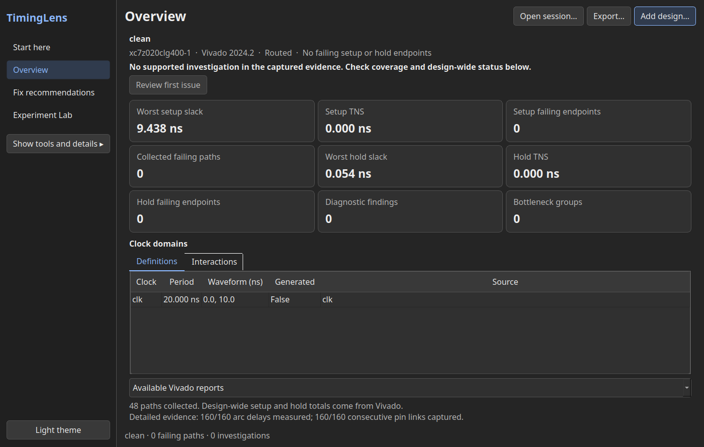
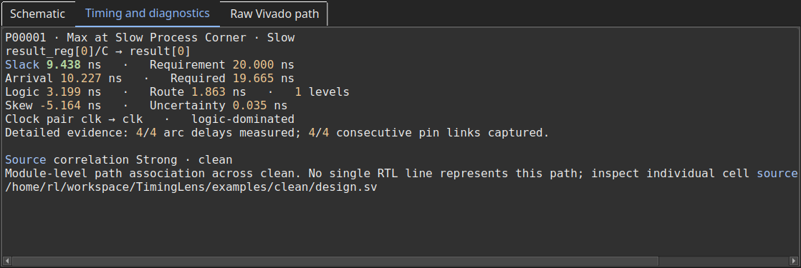

# Clean control · a two-register datapath

Use this design to learn what passing timing looks like. The first register samples eight data bits. The next register captures their XOR with a constant. The clock period is 20 ns. [RTL](design.sv) · [Clock and I/O constraints](timing.xdc) · [Testbench](tb.sv)

From the repository root, generate the routed evidence with Vivado 2024.2, then open the exported session.

```bash
./timinglens.sh demo --run-vivado --design clean --max-paths 48 --output results/verified/clean
./dashboard.sh results/verified/clean/analysis.json
```

In **Overview**, read the setup and hold cards together. In the recorded route, the worst setup slack was **+9.438 ns**, worst hold slack was **+0.054 ns**, and both failing-endpoint counts were zero. TimingLens found no timing issue to investigate.



Expand **Show tools and details → Timing paths**, select a passing setup row, and open **Timing and diagnostics**. Read the launch, capture, and delay breakdown. A passing design can still have many collected paths. This control makes a useful comparison with the [deep logic example](../deep/README.md).



[All examples](../README.md) · [Illustrated user guide](../../docs/visual-guide.md)
