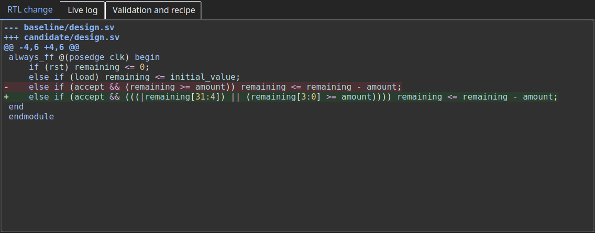
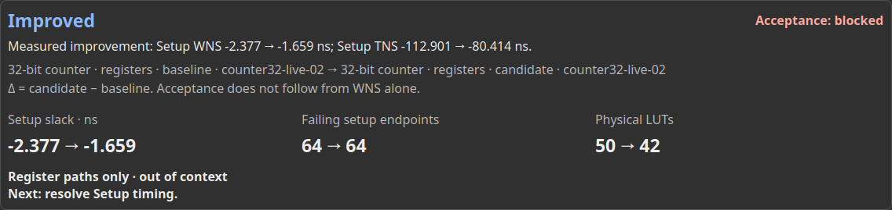

# 32-bit counter · a shorter enable at a 2 ns target

The counter subtracts a four-bit request when `accept` is set and `remaining >= amount`. Equality must allow the subtraction. If any bit of `remaining[31:4]` is high, the count is at least 16 and every possible request fits. Only the low four bits need a magnitude comparison. [Counter RTL](design.sv) · [2 ns constraints](timing.xdc) · [Independent testbench](tb.sv)

In **Show tools and details → Counter experiment**, choose **32-bit unsigned counter · ≥** and **Single recipe · Default**. Inspect **RTL change**. The subtraction, load and reset keep their original priority and clock edge.



Select **Validate and run experiment**. The runner checks both implementations against a finite simulation oracle, then routes them with the same constraints. In **Experiment Lab**, the register WNS improved from **−2.377 to −1.659 ns**, while **64 endpoints still failed**. Physical LUTs fell from **50 to 42**. Open the whole-core comparison as well to inspect the I/O and hold results. [Measured run](../../docs/counter-runner.md#validation-in-this-session)



From the repository root, preview the edit offline. The second command runs the functional checks and routed builds with Verilator and Vivado 2024.2. Choose a fresh output directory for each job.

```bash
./timinglens.sh experiment --example counter32 --preview
./timinglens.sh experiment --example counter32 --output results/counter32-01
```

For a run where this edit closes standalone timing under a different clock and I/O budget, open the [250 MHz walkthrough](../counter32_250/README.md).

[All examples](../README.md) · [Illustrated user guide](../../docs/visual-guide.md)
