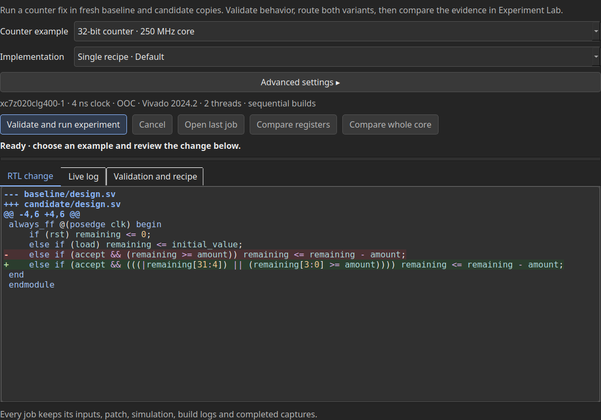
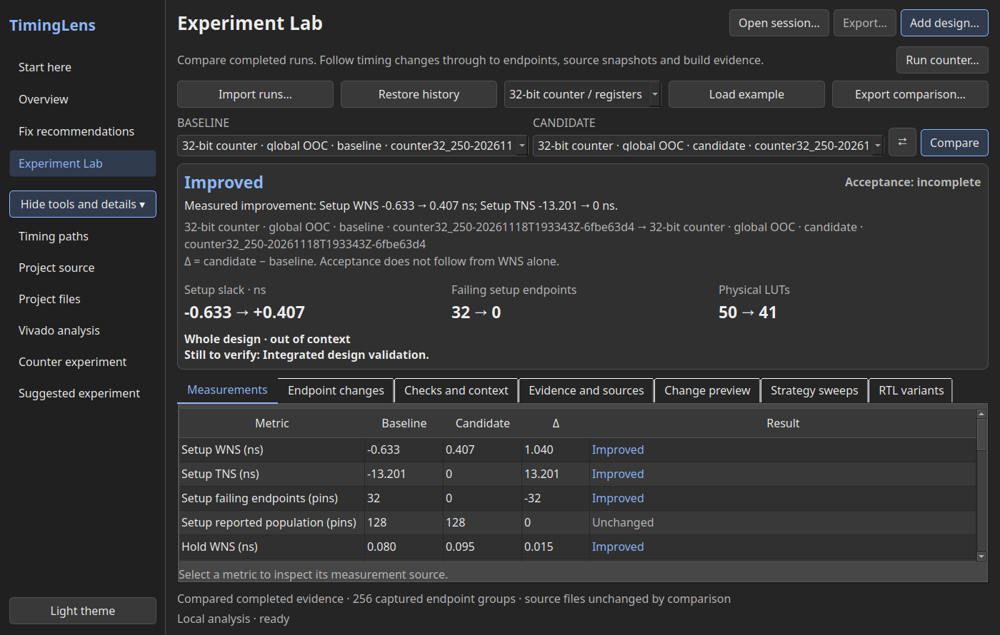

# 250 MHz counter · clear 32 failing setup endpoints

At 250 MHz the counter has **4 ns** between rising edges. Its 32-bit value controls a register enable through the guard `accept && (remaining >= amount)`. The request is four bits wide. A nonzero upper word guarantees that the subtraction fits, leaving only a four-bit comparison when the upper word is zero. [Timer RTL](design.sv) · [Clock and I/O budget](timing.xdc) · [Behavioral oracle](tb.sv)

Open **Start here → Review counter experiment**. Read **RTL change** and **Validation and recipe**. Trace both sides of the guard in the diff. An exact-zero upper word still requires the low-nibble comparison, including equality. Both versions subtract on the original edge.



Choose **Validate and run experiment**. TimingLens simulates both RTL versions and routes them separately using the same clock and recipe. The Lab opens the **whole-core** out-of-context comparison. In the recorded run setup WNS moved from **−0.633 to +0.407 ns**, failing setup endpoints from **32 to 0**, physical LUTs from **50 to 41** and hold slack from **+0.080 to +0.095 ns**.



Read **Checks and context** before reusing the result. The standalone timer passed routed timing. The enclosing FPGA design still needs its own clock, I/O and functional checks. **Compare registers** gives a separate internal-path view. [Full run and scope](../../docs/counter-runner.md#250-mhz-closure-example)

From the repository root, preview the edit offline. The second command runs the functional checks and routed builds with Verilator and Vivado 2024.2. Choose a fresh output directory for each job.

```bash
./timinglens.sh experiment --example counter32_250 --preview
./timinglens.sh experiment --example counter32_250 --output results/counter32_250-01
```

[All examples](../README.md) · [Illustrated user guide](../../docs/visual-guide.md)
