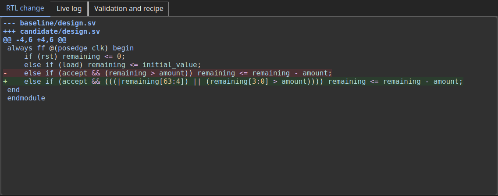
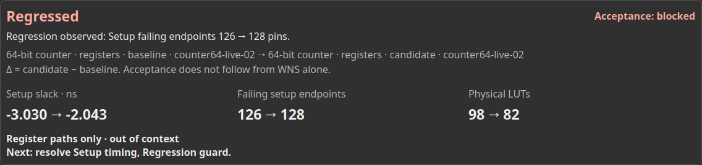
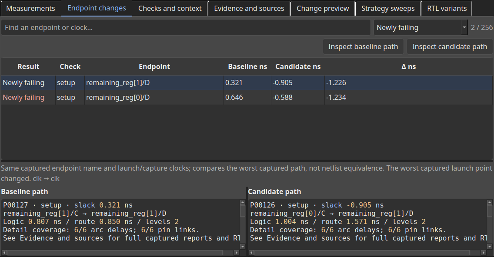
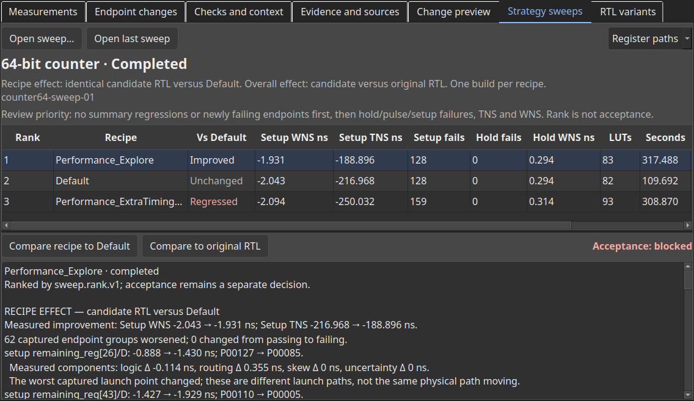

# 64-bit counter · investigate a regression despite better WNS

This guard uses strict `remaining > amount`. When the two values are equal the counter must hold. The candidate reduces the high 60 bits and keeps strict `>` on the low nibble. The experiment uses a 2 ns clock. [RTL](design.sv) · [Constraints](timing.xdc) · [Testbench](tb.sv)

In **Show tools and details → Counter experiment**, choose **64-bit unsigned counter · >**. Read **RTL change**, keep **Single recipe · Default** selected and choose **Validate and run experiment**.



In the register comparison, worst setup slack improved from **−3.030 to −2.043 ns**, but failing endpoints rose from **126 to 128**.



Select **Endpoint changes → Newly failing**. The D pins of bits 0 and 1 crossed from positive to negative slack. Select either row and use **Inspect baseline path** or **Inspect candidate path** to trace it. These counts refer to register endpoint pins, including data and enables.



For a separate experiment, select **Strategy sweep · 3 recipes** in the runner. In **Strategy sweeps**, compare a recipe with Default on the same candidate to isolate its physical implementation effect. Explore improved register WNS to **−1.931 ns**, while whole-core total negative hold slack worsened. [Sweep results](../../docs/strategy-sweeps.md)



From the repository root, preview the edit offline. The second command runs the functional checks and routed builds with Verilator and Vivado 2024.2. Choose a fresh output directory for each job.

```bash
./timinglens.sh experiment --example counter64 --preview
./timinglens.sh experiment --example counter64 --output results/counter64-01
```

[All examples](../README.md) · [Illustrated user guide](../../docs/visual-guide.md)
