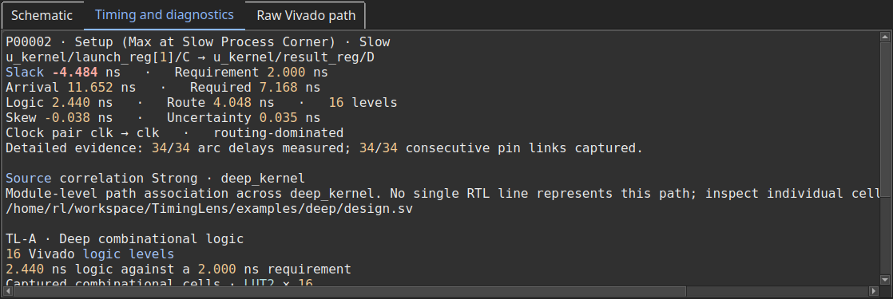
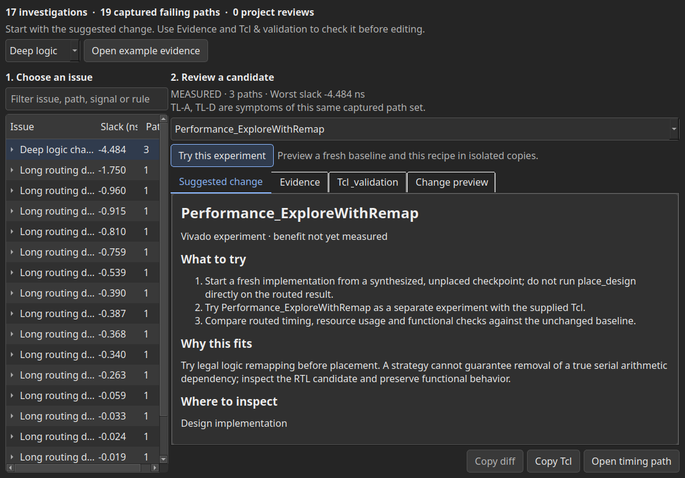

# Deep logic · remap a serial logic chain

A 17-bit input feeds 16 dependent XOR/invert and AND stages. The output register needs the final value at the next edge of a 2 ns clock. Follow a register path to see the cost of putting the entire chain in one cycle. [RTL](design.sv) · [Constraints](timing.xdc) · [Functional check](tb.sv)

From the repository root, generate the routed evidence with Vivado 2024.2, then open the exported session.

```bash
./timinglens.sh demo --run-vivado --design deep --max-paths 48 --output results/verified/deep
./dashboard.sh results/verified/deep/analysis.json
```

In **Timing paths**, find the setup path from `u_kernel/launch_reg[1]/C` to `u_kernel/result_reg/D`. It was **P00002** in this capture. **Timing and diagnostics** shows 16 logic levels and **−4.484 ns** slack. The delays include both the cells and the wires connecting the stages.



Open **Fix recommendations → Deep logic → Open example evidence**. Choose the remap recommendation, then **Try this experiment** to inspect the Vivado recipe. **Run isolated experiment** builds a Default baseline and a candidate with remapping, placement and routing changes while holding RTL and constraints fixed.



The resulting register WNS improved to **−0.737 ns**. In the full example, WNS moved only from **−8.225 to −8.163 ns**. Use the two Lab populations to see why the selected cone improved while the design still missed timing. [Recipe and comparison procedure](../../docs/recommendation-experiments.md)

[All examples](../README.md) · [Illustrated user guide](../../docs/visual-guide.md)
