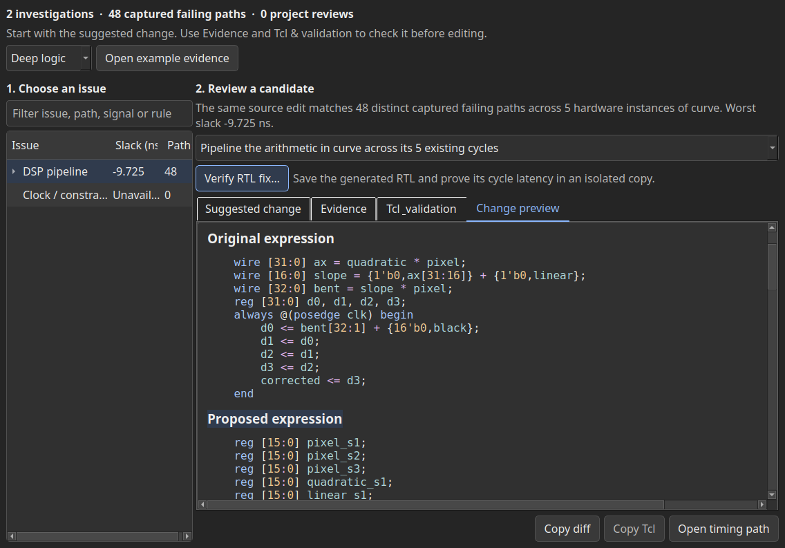
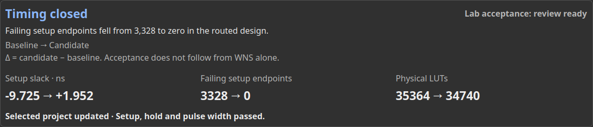

# Dense Zybo implementation benchmarks

Each example builds a self-contained Vivado project for the Zybo Z7-20 (XC7Z020-1). All three use an 8 ns fabric clock. Every lane has a distinct deterministic sample stream and a 1,024-word history RAM. A registered reduction carries each lane's result to the output. The input projects contain only the original implementation.

| Project | Workload | Failure under investigation |
| --- | --- | --- |
| `iq_power` | 72 parallel window-weighted I/Q power estimators, with two 16-sample rank filters per lane | Two squares, a sum and a weighted product precede a four-register delay line. |
| `tone_curve` | 104 parallel fixed-point quadratic tone curves with a local contrast pedestal | Two dependent multiplies and the black-level addition precede a five-register delay line. |
| `pixel_gain` | 112 instantiations of an IP Integrator block design containing a Xilinx Multiplier Generator | A single-stage 20 × 16 unsigned gain multiplier uses LUTs throughout the replicated datapath. |

## Follow a design in TimingLens

Choose a workload to see its original RTL or IP configuration, the change under test, and its own before/after screenshots.

| Walkthrough | What to follow in the GUI |
| --- | --- |
| [I/Q power](iq_power/README.md) | Track the weight alongside the two squared samples through four cycles. |
| [Tone curve](tone_curve/README.md) | Trace the dependent multiplies and align the black level with the correct pixel. |
| [Pixel gain](pixel_gain/README.md) | Compare LUT implementation with DSP48 mapping at the same one-cycle interface. |

For the tone curve, open **Fix recommendations → Change preview** on the routed baseline to see which operations move. Open **Experiment Lab → Measurements** on the completed pair to see whether the five-cycle schedule met the 8 ns budget.





## Build a project

From the repository root, with Vivado on the path, choose a fresh destination for each command. Replace `pixel_gain` with either of the other project names to run it.

```bash
vivado -mode batch -source examples/dense-suite/create.tcl -tclargs \
  "$PWD/examples/dense-suite" pixel_gain "$PWD/work/bench/pixel_gain"
./timinglens.sh auto-fix --project work/bench/pixel_gain/pixel_gain.xpr \
  --output results/pixel-gain-auto
```

Add `--apply-to-source` to publish a passing change to the selected project. The new job contains the routed baseline, candidate, functional evidence, backup when requested, and portable Lab comparison. The fixed project can be reopened in Vivado. All examples run on the host.


To check the full streaming datapath independently, run the native XSim scoreboard on a completed baseline or candidate project. It checks all lanes for 256 cycles after RAM warm-up and checks the top-level output signature. The pixel-gain test uses the generated native IP simulation sources from the route.

```bash
.venv/bin/python examples/dense-suite/check_stream.py \
  results/pixel-gain-auto/candidate-1/project/pixel_gain.xpr work/stream-check
```

## Routed measurements

Vivado 2024.2 measured the following whole-design results on the XC7Z020CLG400-1 with the same 125 MHz clock and implementation recipe before and after each change.

| Project | Occupied slices, before → after | DSPs, before → after | Setup WNS, before → after | Failing setup endpoints | Candidate hold slack |
| --- | --- | --- | --- | --- | --- |
| I/Q power | 83.77% → 80.84% | 216 → 216 | −1.945 → +0.935 ns | 1,152 → 0 | +0.015 ns |
| Tone curve | 87.19% → 87.29% | 208 → 208 | −9.725 → +1.952 ns | 3,328 → 0 | +0.020 ns |
| Pixel gain | 91.32% → 16.98% | 0 → 112 | −1.004 → +1.480 ns | 1,462 → 0 | +0.020 ns |

I/Q power and tone curve passed their RTL equivalence gates. The pixel-gain edit preserved the one-cycle interface in native IP simulation. The full-design scoreboard checked 18,432, 26,624 and 28,672 lane results respectively on each side, plus 256 top-level output samples per design. The timing-closed pixel-gain control yielded zero edits.

For pixel gain, the mapped DSPs generated 224 DPIP-1 and 112 DPOP-2 pipeline advisories. They document a performance/power tradeoff at the preserved latency. The candidate passed setup, hold, pulse width, routing and error/critical-warning DRC checks. The strict Lab comparison displays the warning increase and the reduction in positive hold margin.

During sizing, a 32-sample I/Q window and a 12-tap tone frontend exceeded the Zybo's placement capacity. The paired measurements above use the same 16-sample and 9-tap workloads on both sides.

[All examples](../README.md) · [Illustrated user guide](../../docs/visual-guide.md)
