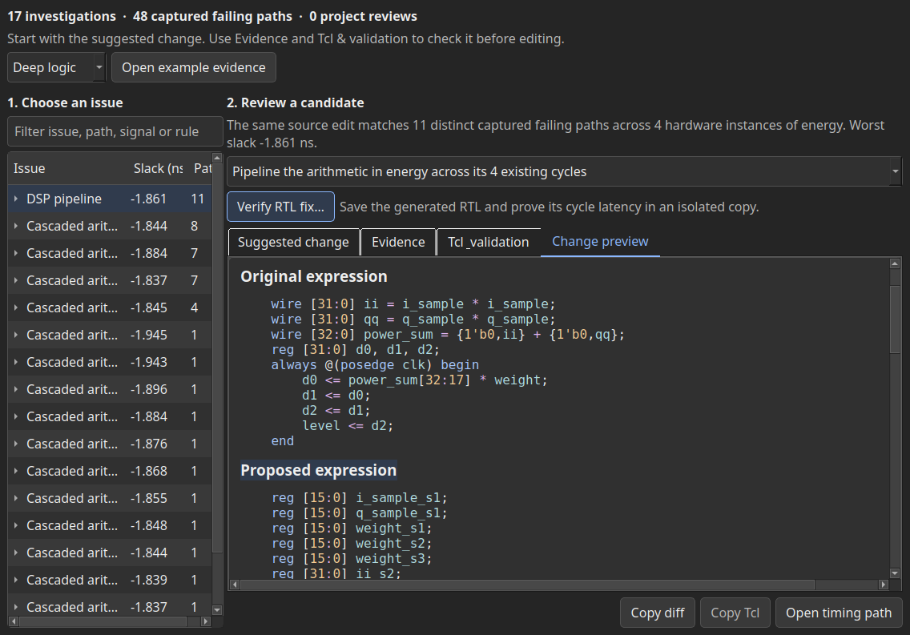
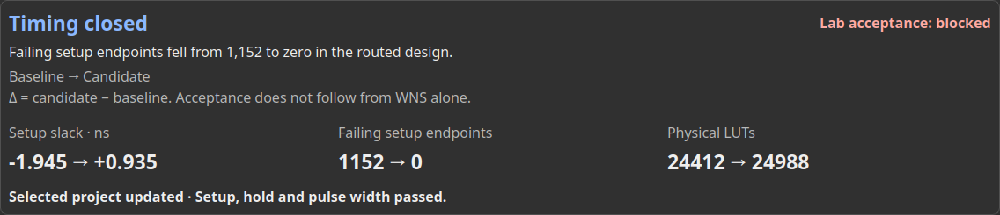

# I/Q power · pipeline a weighted sum of squares

Each of 72 lanes squares its I and Q samples, adds the squares, takes the selected high bits and multiplies by a sample-specific weight. In the original `energy` module, the first register waits for that entire calculation. Three later registers delay the answer. The external interface already allows four cycles. [Energy calculation](energy.v) · [Window weighting](rank_weight.v) · [Complete design](iq_power.v)

Create the original project from the repository root with Vivado 2024.2 on your path. Use new output directories for both commands.

```bash
vivado -mode batch -source examples/dense-suite/create.tcl -tclargs \
  "$PWD/examples/dense-suite" iq_power "$PWD/work/bench/iq_power"
./timinglens.sh auto-fix --project work/bench/iq_power/iq_power.xpr \
  --output results/iq_power-01
```

To run the same experiment in the GUI, open the generated `.xpr` with **Add design…**, choose **Apply verified fixes in a project copy** and **Run and apply verified fixes**. The [suite instructions](../README.md) also show how to run the independent full-stream scoreboard on each built project.

Open the job’s `baseline/analysis/analysis.json`, select the DSP pipeline investigation in **Fix recommendations**, and open **Change preview**. Trace one sample’s I, Q and weight through the proposed stages. The arithmetic can now use the four existing cycles, as long as the weight still reaches the multiply with the correct sample.



In **Experiment Lab**, compare the fitted 16-sample-window design. At **125 MHz**, setup WNS moved from **−1.945 to +0.935 ns** and **1,152 failing endpoints fell to zero**. Both builds used **216 DSPs**. The leaf equivalence proof checks cycle alignment and the independent stream scoreboard exercises the assembled design. The Lab also records the drop in positive hold margin from +0.023 to +0.015 ns. [Routed measurements](../../../docs/measurements/dense-projects.json)



[All examples](../../README.md) · [Illustrated user guide](../../../docs/visual-guide.md)
