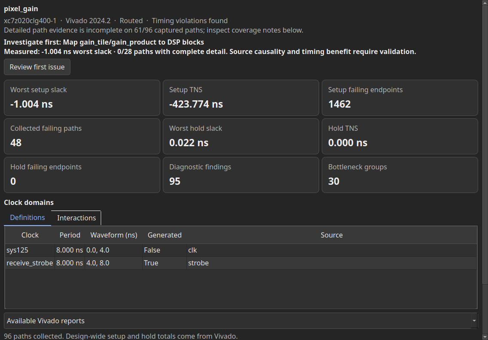
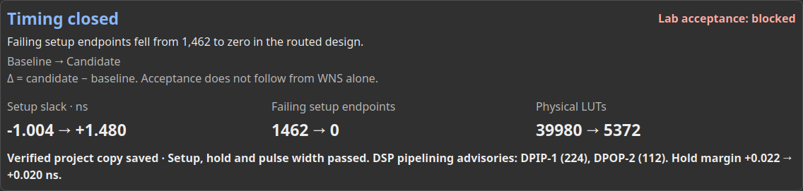

# Pixel gain · move a one-cycle multiplier into DSP hardware

Each of 112 lanes multiplies a 20-bit unsigned sample by a 16-bit gain and returns a 36-bit product in one cycle. **Multiplier Generator v12.0** is the version of AMD/Xilinx’s configurable multiplier IP instantiated inside the Vivado block design. Here its initial `Multiplier_Construction` is `Use_LUTs`, so the multiply is built from fabric logic. [IP settings and connections](ip.tcl) · [Replicated datapath](pixel_gain.v)

Create the original project from the repository root with Vivado 2024.2 on your path. Use new output directories for both commands.

```bash
vivado -mode batch -source examples/dense-suite/create.tcl -tclargs \
  "$PWD/examples/dense-suite" pixel_gain "$PWD/work/bench/pixel_gain"
./timinglens.sh auto-fix --project work/bench/pixel_gain/pixel_gain.xpr \
  --output results/pixel_gain-01
```

To run the same experiment in the GUI, open the generated `.xpr` with **Add design…**, choose **Apply verified fixes in a project copy** and **Run and apply verified fixes**. The [suite instructions](../README.md) also show how to run the independent full-stream scoreboard on each built project.

Open `baseline/analysis/analysis.json` in **Overview** to see the original clock and failure count. The automatic fix traces the failing logic to `gain_tile/gain_product` and changes the implementation to dedicated DSP48 blocks. It keeps both operand widths, the full product and the single-cycle interface, and checks both IP configurations in native simulation.



Read **Experiment Lab → Measurements** and **Checks and context** together. At 125 MHz, WNS moved from **−1.004 to +1.480 ns** and **1,462 failing endpoints fell to zero**. Occupied slices dropped from **91.32% to 16.98%** and DSP use rose from **0 to 112**. Keeping one-cycle latency left internal DSP registers unused. Vivado recorded **336 DSP pipeline advisories**, and positive hold slack dipped to +0.020 ns. [Timing and validation evidence](../../../docs/measurements/dense-projects.json)



The [resource-balance workload](../../resource-balance/README.md) uses a different pixel-gain build to exercise a utilization budget.

[All examples](../../README.md) · [Illustrated user guide](../../../docs/visual-guide.md)
