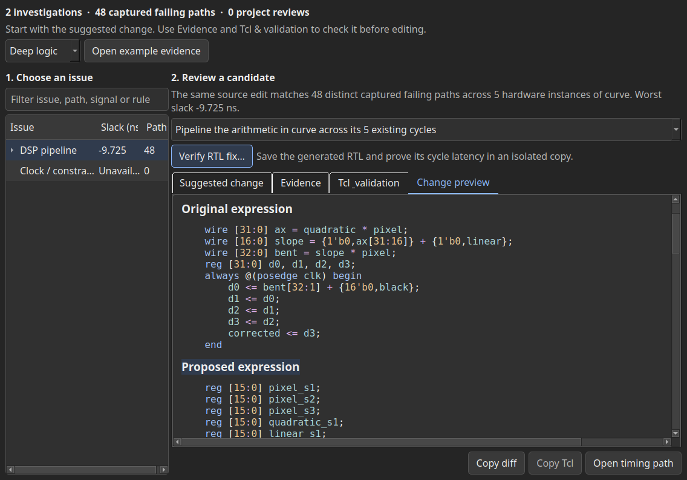
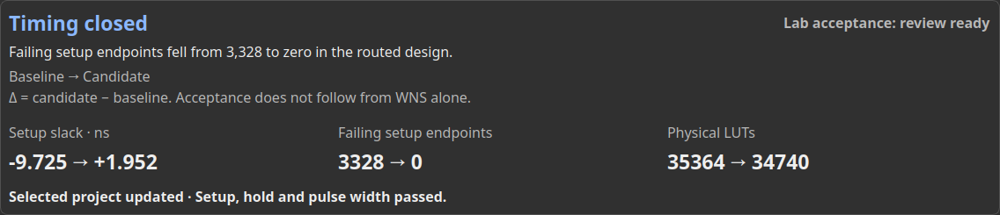

# Tone curve · move dependent multiplies into existing cycles

A 104-lane video datapath evaluates a fixed-point quadratic tone curve. The second multiply depends on the truncated result of the first. The original `curve` computes both multiplies, the slope and black-level offset before its first register. Four more registers delay the result. Each output must still correspond to the pixel accepted five edges earlier. [Curve arithmetic](curve.v) · [Local contrast](local_contrast.v) · [Complete design](tone_curve.v)

Create the original project from the repository root with Vivado 2024.2 on your path. Use new output directories for both commands.

```bash
vivado -mode batch -source examples/dense-suite/create.tcl -tclargs \
  "$PWD/examples/dense-suite" tone_curve "$PWD/work/bench/tone_curve"
./timinglens.sh auto-fix --project work/bench/tone_curve/tone_curve.xpr \
  --output results/tone_curve-01
```

To run the same experiment in the GUI, open the generated `.xpr` with **Add design…**, choose **Apply verified fixes in a project copy** and **Run and apply verified fixes**. The [suite instructions](../README.md) also show how to run the independent full-stream scoreboard on each built project.

Open the job’s `baseline/analysis/analysis.json` and go to **Fix recommendations → Change preview** for the DSP pipeline. Follow the pixel and black-level input alongside the intermediate slope. Moving just the multiplies would risk adding one pixel’s offset to a different pixel.



In the fitted nine-tap design, the candidate passed leaf equivalence and the full-stream scoreboard. Whole-design setup WNS improved from **−9.725 to +1.952 ns** and **3,328 failing endpoints fell to zero**. DSP use stayed at **208** and candidate hold slack was **+0.020 ns**. [Measurements](../../../docs/measurements/dense-projects.json)



[All examples](../../README.md) · [Illustrated user guide](../../../docs/visual-guide.md)
