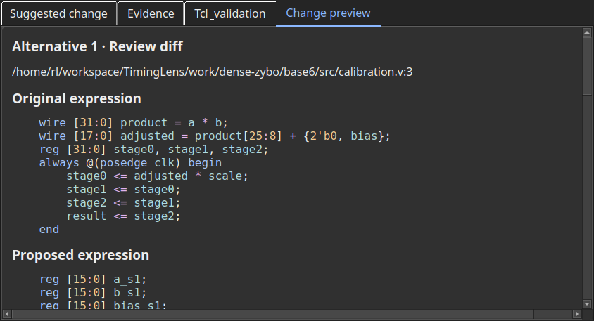
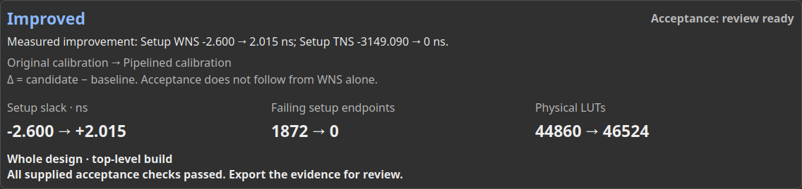

# Dense Zybo Z7-20 timing-closure experiment

This programmable-logic benchmark compares two implementations of the same 104-lane waveform monitor on the xc7z020clg400-1. The complete IP Integrator design uses 13 eight-lane processing banks, a bank combiner and a registered readout. Each lane accepts one 32-bit word per cycle from its own repeatable on-chip test source. A circular 1,024-word RAM supplies six historical reference words. The lane sums the Hamming distances between its query and those six words, then applies a two-multiply calibration with a per-sample offset and scale. Every lane contributes to the four-bit output digest.

The design uses the board's 125 MHz fabric oscillator. Four data outputs launch on its rising edge. An ODDR forwards the falling edge as the rising sampling edge on a fifth output. The XDC specifies a 0.750 ns maximum and −0.350 ns minimum receiver delay as an experiment assumption. Vivado's check_timing reports one LOW no_output_delay item on the forwarded clock port. The detailed report shows zero data ports missing an output delay and zero unconstrained internal endpoints. Pin assignments follow the [Digilent Zybo Z7 master constraints](https://github.com/Digilent/digilent-xdc/blob/master/Zybo-Z7-Master.xdc).

## Inspect the calibration in TimingLens

Open the reproduced baseline’s `original/timinglens/analysis.json` in **Open session…**. In **Fix recommendations**, choose the DSP pipeline investigation and open **Change preview**. Follow the sample’s operands and its bias and scale through the proposed four stages. [Original implementation](original/README.md) · [Revised implementation](revised/README.md)



In **Experiment Lab → Import runs…**, select both records from the reproduced `lab/` directory, choose the original as baseline and the revised build as candidate, then **Compare**. The result card shows the recovery in setup and its LUT cost. Use **Checks and context** for the equivalence, simulation and physical evidence.



## Routed result

| Vivado 2024.2, 125 MHz | Original | Revised |
| --- | ---: | ---: |
| Worst setup slack | −2.600 ns | +2.015 ns |
| Total negative setup slack | −3,149.090 ns | 0.000 ns |
| Failing setup endpoints | 1,872 | 0 |
| Worst hold slack | +0.006 ns | +0.017 ns |
| Failing hold or pulse-width endpoints | 0 | 0 |
| Occupied slices out of 13,300 | 13,278 (99.83%) | 13,256 (99.67%) |
| LUTs out of 53,200 | 44,860 (84.32%) | 46,524 (87.45%) |
| Slice registers | 80,872 | 79,000 |
| DSP48E1s out of 220 | 208 | 208 |
| Block RAM tiles out of 140 | 104 | 104 |

The revised design fully routed all 106,806 routable nets and passed setup, hold and pulse-width checks. On the original worst path in bank 4, TimingLens identified a RAMB36E1 launch, a DSP multiply arc and five consecutive CARRY4 cells in the calibration logic. The data path took 10.221 ns, including 7.180 ns of logic and 3.041 ns of routing. The Vivado timing summary and independently reopened TimingLens sessions agree on both designs' setup and hold totals.

The retiming costs 1,664 LUTs and saves 1,872 slice registers. Occupancy measures slices containing at least one placed primitive. Individual resource percentages give the remaining headroom by resource type. The revised default DRC report has zero errors and zero critical warnings, with 724 warnings, down from 968. These include DSP pipeline and LUT-packing advisories, plus the absent PS7 in this programmable-logic-only design. The measured pass applies to the routed design and the declared I/O budget. Physical-board operation has not been tested.

## RTL change

In the original calibration, the first register samples a product, an 18-bit modular addition and a second product, all computed in one cycle. Three subsequent registers delay the result. TimingLens traced a failing path from a RAM output through the first DSP and carry chain to the second DSP. The revised calibration uses the same four register stages to capture operands, multiply, add the bias, and finally multiply by the scale. It delays bias and scale to keep them paired with their input transaction. Both versions produce one result per lane per tick with the same four-cycle latency.

Both builds use the same device, BD generator, hierarchy setting, XDC and Default placement, physical optimization and routing directives. The only source edit between the frozen inputs is `calibration.v`. The eight-tap prototype used for sizing was excluded from the comparison. Both routed versions use six taps.

## Functional evidence

* XSim runs each complete generated BD with the vendor ODDR model. An independent Python model computes the expected 32-bit result for each lane directly from the input sequence, RAM history, bit counts and modular arithmetic. The scoreboard checks 2,560 consecutive output cycles after initialization, 266,240 lane results per build, the output digest and both forwarded-clock edges.
* Yosys translates each calibration into a synchronous word-level transition function. Z3 compares all 32 output bits with independent, arbitrary 16-bit operands on every cycle and arbitrary initial register states. The solver finds a counterexample after only three edges and proves that no mismatch is possible after four. This proof covers the changed calibration under two-state semantics. The integrated simulation covers its surrounding fabric.

## TimingLens-generated fix

Starting from the original routed session alone, Fix recommendations traces 100 sampled failures across 49 instances to the same calibration source. It generates the operand capture, first multiply, modular addition and final multiply within the existing four cycles. **Verify RTL fix…** stages the generated source and runs a word-level equivalence check. A fresh Default implementation of the generated RTL reproduced +2.015 ns setup and +0.017 ns hold slack. The full-design scoreboard checked 266,240 lane results. This run used generated register names and its own routed checkpoint.

## Reproduce

With Vivado 2024.2, TimingLens, Yosys with the functional SMT backend, and Z3 installed, run the following from the TimingLens checkout. The script requires a new directory and retains both projects, checkpoints, native reports, simulations, portable TimingLens sessions and the Experiment Lab comparison.

```bash
export TIMINGLENS_VIVADO=/opt/amd/xilinx/Vivado/2024.2/bin/vivado
export TIMINGLENS_PYTHON="$PWD/.venv/bin/python"
export TIMINGLENS_YOSYS="$PWD/.venv/bin/yowasp-yosys"
export TIMINGLENS_Z3_LIBRARY=/opt/amd/xilinx/Vivado/2024.2/lib/lnx64.o/libz3.so
mkdir -p work
examples/dense-zybo/reproduce.sh "$PWD/work/dense-zybo-reproduction"
```

Open either `timinglens/analysis.json` with **Open session**, or import `lab/baseline.run.json` and `lab/candidate.run.json` in **Experiment Lab**. The offline HTML comparison and native reports can also be read directly. The optional `plot_placement.py` draws the actual candidate SLICE site occupancy from the exported TSV and Lab comparison.

[All examples](../README.md) · [Illustrated user guide](../../docs/visual-guide.md)
