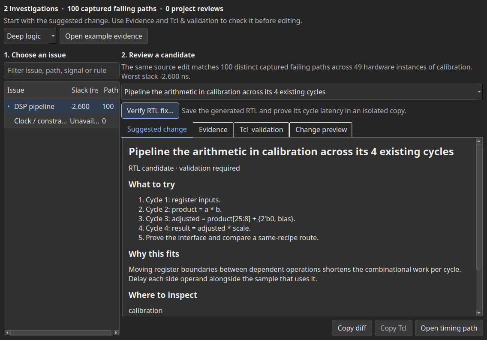

# Original calibration · trace the long arithmetic path

This is the baseline leaf of the 104-lane waveform monitor. The first register captures a multiply, truncation, modular bias addition and rescaling multiply. Three later registers shift the finished value. Read the [four-cycle RTL](calibration.v), then use the [parent reproduction steps](../README.md#reproduce) to build both integrated designs.

Open `original/timinglens/analysis.json` from the reproduction directory. Under **Fix recommendations**, select the DSP pipeline investigation. The worst path launches from a block RAM and includes a DSP arc and five carry cells. **Change preview** shows how the design can spend its existing four cycles on useful work. The original routed at **−2.600 ns WNS** with **1,872 failing setup endpoints**.

Compare the [revised leaf and its timing results](../revised/README.md) before adopting the edit.

[All examples](../../README.md) · [Illustrated user guide](../../../docs/visual-guide.md)
