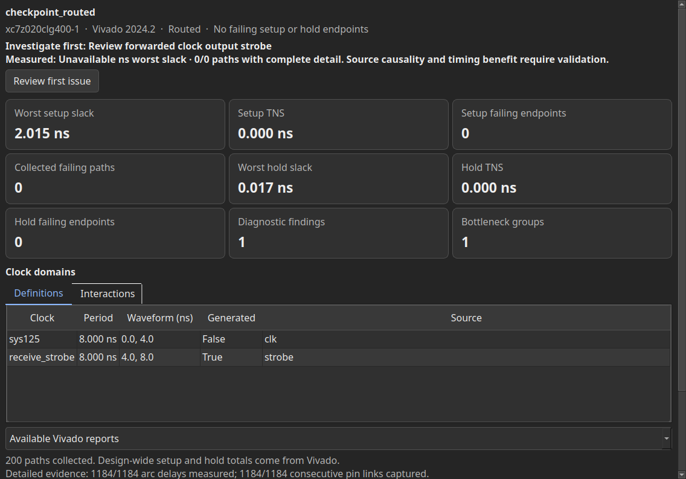
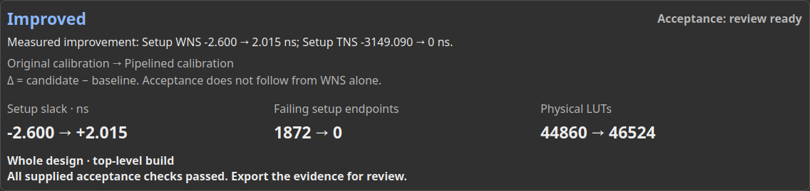

# Revised calibration · check sample alignment and timing

The [revised RTL](calibration.v) captures the operands, multiplies, adds the bias, then rescales. Delay registers carry each sample’s bias and scale to the consuming stage. The four-cycle interface and one-result-per-cycle throughput stay the same. [Original leaf](../original/README.md) · [Reproduce both builds](../README.md#reproduce)

Open `revised/timinglens/analysis.json` from the reproduction directory. In **Overview**, check that setup, hold and endpoint counts agree with the native summary. Then use **Experiment Lab → Import runs…** to compare the two records in `lab/`. At 125 MHz the revised design has **+2.015 ns setup**, **+0.017 ns hold** and **zero failing setup endpoints**. The parent example includes the leaf equivalence proof and the scoreboard for all 104 lanes.

[All examples](../../README.md) · [Illustrated user guide](../../../docs/visual-guide.md)
