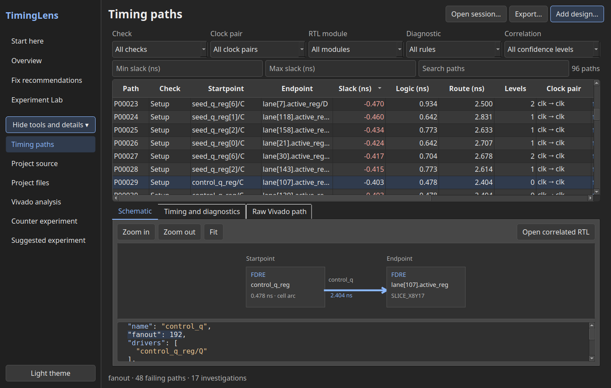
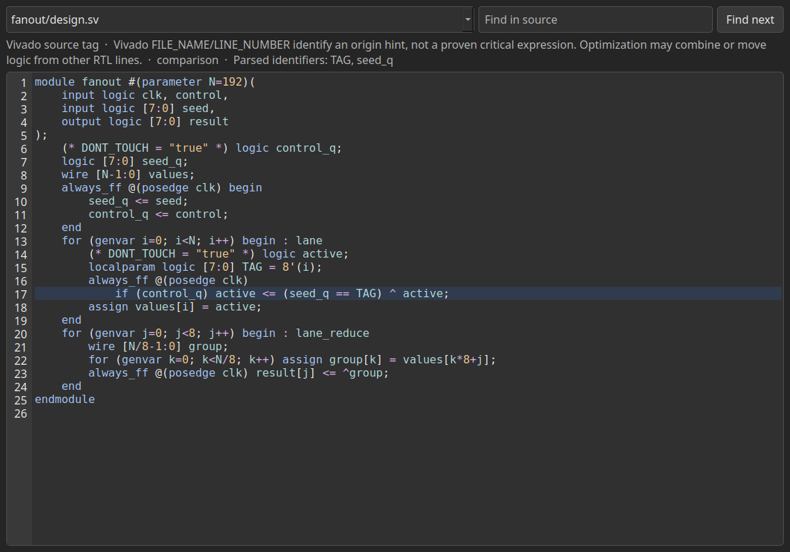

# High fanout · trace a slow clock-enable branch

One registered control drives the enables of 192 lane registers on a 3 ns clock. Each lane does little logic, but the routes from the shared driver have different delays. The question is which physical branch consumed the receiving register’s budget. [RTL](design.sv) · [Constraints](timing.xdc) · [Testbench](tb.sv)

From the repository root, generate the routed evidence with Vivado 2024.2, then open the exported session.

```bash
./timinglens.sh demo --run-vivado --design fanout --max-paths 48 --output results/verified/fanout
./dashboard.sh results/verified/fanout/analysis.json
```

Open **Timing paths**, find `lane[107].active_reg/CE` and select the setup path from `control_q_reg/Q` (**P00029** here). Click the `control_q` net in **Schematic**. Its fanout is 192. **Timing and diagnostics** attributes **2.404 ns** of the **2.882 ns** datapath to that branch.



Click the receiving register and **Open cell RTL** to see the enable condition inside the generated lane. Use this source link to locate the consumer, then return to the graph for its measured delay.



In **Fix recommendations**, choose the high-fanout physical optimization and **Try this experiment**. The candidate runs `AggressiveFanoutOpt` on a copy of the baseline’s placed checkpoint and reroutes it. Register setup WNS worsened from **−0.664 to −0.759 ns**. Keep the baseline when reviewing this candidate. [Experiment recipe and validation](../../docs/recommendation-experiments.md)

[All examples](../README.md) · [Illustrated user guide](../../docs/visual-guide.md)
