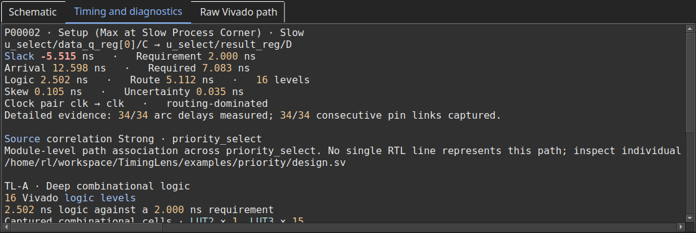
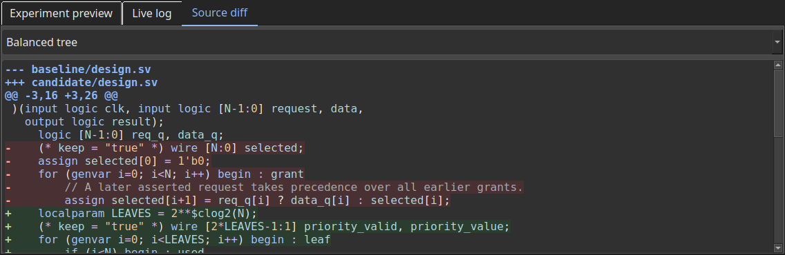
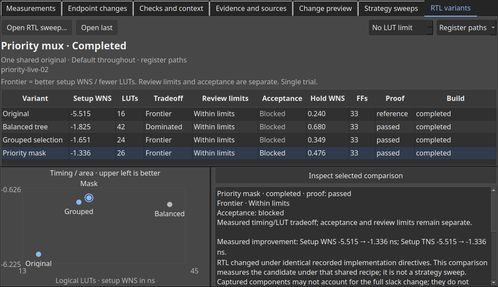

# Priority selection · compare three equivalent RTL structures

Sixteen request bits compete to supply one data bit. When multiple requests are asserted together, the highest numbered lane must win. In the original RTL each lane chooses between its own value and the winner so far. [Priority chain](design.sv) · [2 ns clock](timing.xdc) · [Overlapping-request testbench](tb.sv)

From the repository root, generate the routed evidence with Vivado 2024.2, then open the exported session.

```bash
./timinglens.sh demo --run-vivado --design priority --max-paths 48 --output results/verified/priority
./dashboard.sh results/verified/priority/analysis.json
```

In **Timing paths**, inspect **P00002** in this capture. The register path missed setup by **5.515 ns**. TimingLens traced 15 connected mux stages back to `priority_select`. That dependency explains why changing selection order alone could change behavior.



Choose **Fix recommendations → Priority mux → Open example evidence → Verified RTL variants · 3 candidates → Try this experiment**. Inspect the **Source diff** for each variant. The tree merges pairs, the grouped version picks local winners first, and the mask excludes lower lanes when a higher request wins. **Run isolated experiment** proves each rewrite with Yosys, simulates it and routes it against the same original at the same clock and Default recipe.



In **Experiment Lab → RTL variants**, select a point to read its WNS, logical LUT count and proof. The original used **16 LUTs** at **−5.515 ns**. The grouped version used **24** at **−1.651 ns**, and the mask used **26** at **−1.336 ns**. All three candidates still missed setup. Switch to **Full example** to check the rest of the design before choosing a change. [All variants and proof scope](../../docs/rtl-variant-sweeps.md)



[All examples](../README.md) · [Illustrated user guide](../../docs/visual-guide.md)
