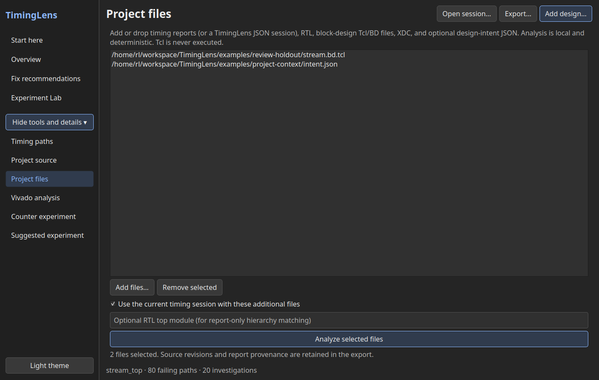
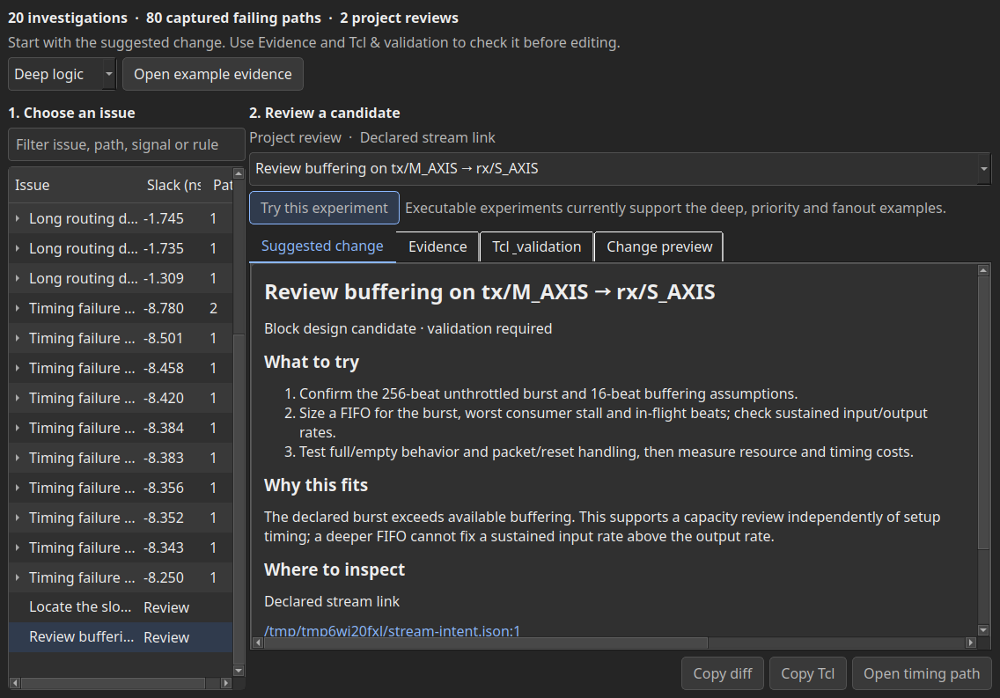

# Project context · add a traffic or clock contract

TimingLens can measure slack from a timing report. The report cannot tell it how long a sensor can transmit without pausing or how many cycles a receiver promises to hold data stable. [intent.json](intent.json) shows how to supply those facts. Its example interface names, clock names and bounds are placeholders.

## Stage the context

Open **Add design…** and select a timing session or reports alongside the design’s BD/Tcl, RTL, XDC and a copy of the intent file. If a session is already open, use **Project files → Use the current timing session with these additional files**. Select **Analyze selected files**. The screenshot stages the shipped template alongside the [stream holdout’s BD connections](../review-holdout/stream.bd.tcl).



## Try the buffering review offline

First generate the stream session with the [holdout build instructions](../review-holdout/README.md). After that build, this review runs offline. The holdout’s literal link runs from `tx/M_AXIS` to `rx/S_AXIS`. For this exercise, assume the producer can deliver 256 beats without stopping and only 16 beats of buffering are available. Save the following as `work/stream-intent.json` after creating `work/`. These are hypothetical traffic bounds for the exercise.

```json
{
  "timinglens_intent": 1,
  "stream_links": [{
    "source": "tx/M_AXIS",
    "sink": "rx/S_AXIS",
    "max_burst_beats": 256,
    "buffer_capacity_beats": 16,
    "reason": "Exercise assumption: the producer cannot pause during this burst."
  }]
}
```

```bash
./timinglens.sh inspect --files work/my-heldout/stream/review/analysis.json \
  work/stream-intent.json --output results/stream-intent
./dashboard.sh results/stream-intent/analysis.json
```

Under **Fix recommendations**, choose **Review buffering on tx/M_AXIS → rx/S_AXIS**. TimingLens matches the declared link and explains the capacity shortfall if the consumer stalls throughout the burst. Check maximum stalls, in-flight beats and sustained rate before choosing a depth. The saved stream session supplies its routed paths and its embedded BD connection declarations.



For clock-domain or multicycle review, supply the actual clock names or launch/capture pins, timing evidence and a functional reason in the corresponding sections of the template. Inspect **Tcl & validation** for coverage checks and any commented constraint template. An exception changes which paths Vivado times. [Intent fields and matching rules](../../docs/project-analysis.md#design-intent-and-timing-exceptions)

[All examples](../README.md) · [Illustrated user guide](../../docs/visual-guide.md)
