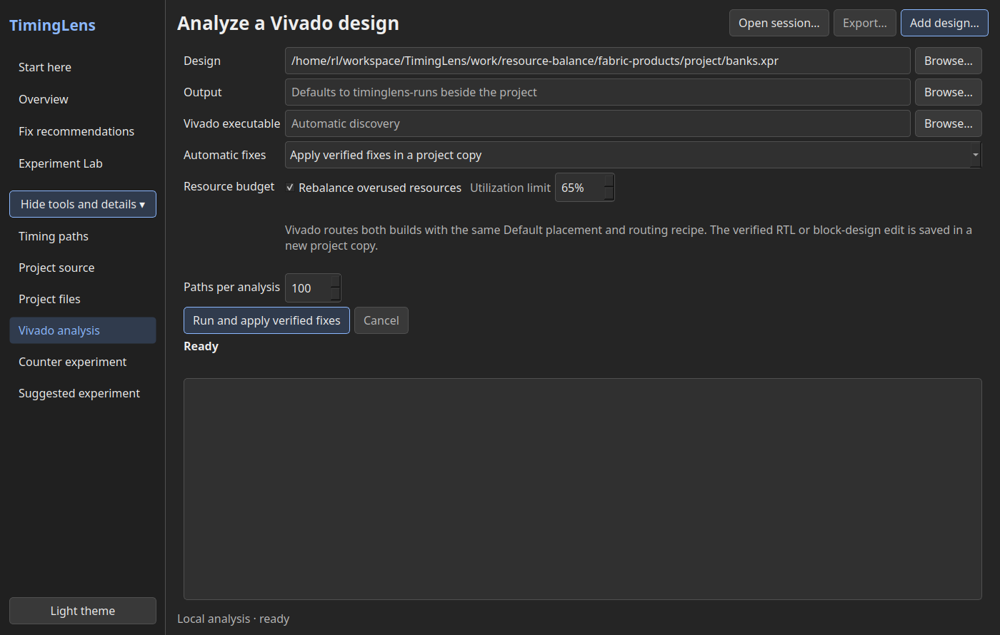
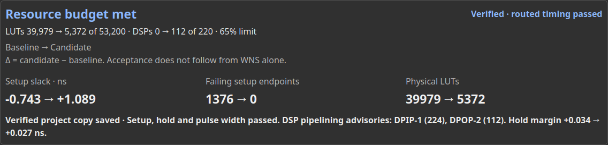
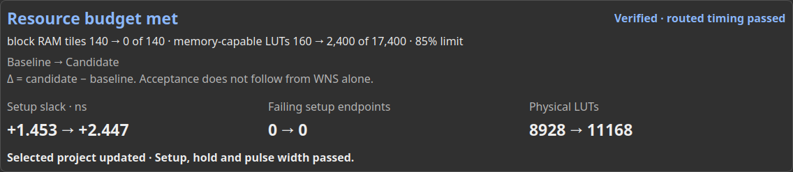
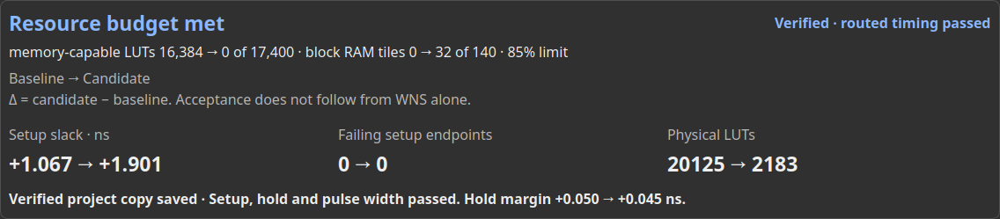
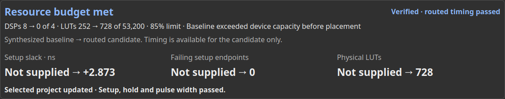
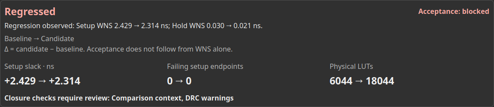
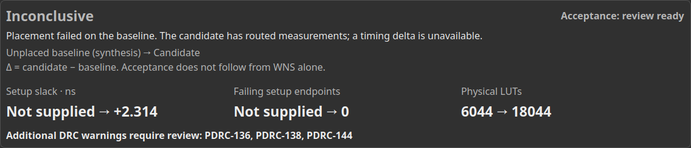
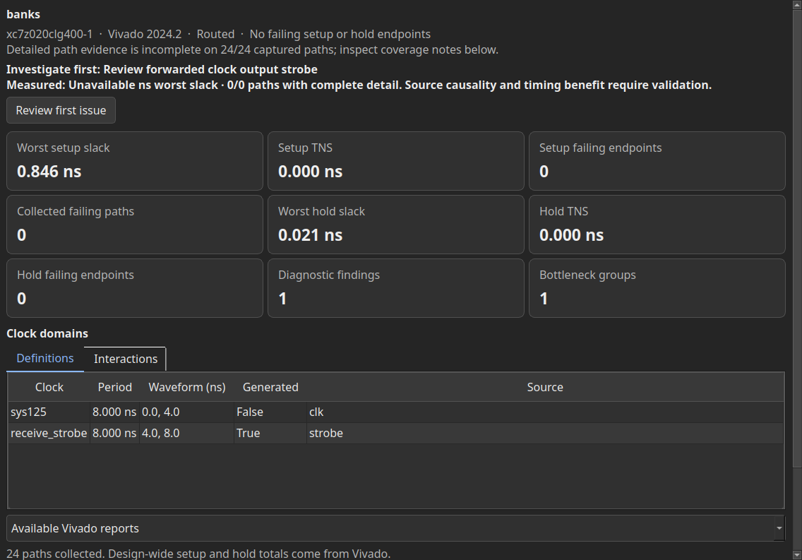

# Resource-balancing workloads for the Zybo Z7-20

Each example generates a self-contained Vivado project for the XC7Z020 with the same 125 MHz clock and a registered readout. Independent inputs drive every lane, and the output signature consumes each lane. Run these host-side builds from the repository root with Vivado on PATH.

```sh
vivado -mode batch -source examples/resource-balance/create.tcl -tclargs /tmp/banks-input memory
./timinglens.sh auto-fix --project /tmp/banks-input/banks.xpr --resource-limit 85 --output /tmp/banks-experiment
```

| Project argument | Workload | Resource decision to exercise |
| --- | --- | --- |
| `memory` | 300 independent 64 × 8 read-first stores | Move short stores from block RAM into memory-capable LUTs. |
| `lutram` | 64 independent 512 × 32 distributed stores | Move storage into block RAM. |
| `multiplier` | 200 three-stage unsigned 8 × 8 Xilinx Multiplier Generator instances | Move products off DSP48s and into fabric. |
| `fabric-products` | 112 fabric-based 20 × 16 pixel-gain IPs with 512-deep independent histories | Move the LUT multipliers into DSPs. Use a 65% budget. |
| `reserved-dsp` | The same 200 multipliers, with 40 DSP sites reserved by the XDC | Try the same fabric implementation while retaining the site reservation. |
| `small-region` | Eight multipliers sharing four usable DSP sites | Recover a physically unplaceable reserved design using LUT logic. |
| `overfull-dsp` | 232 independently driven multipliers on a device with 220 DSPs | Exercise synthesis spill and measure the resulting implementation. Vivado may spend additional time rewriting repeated DSPs during synthesis. |

Use a fresh directory for each project and each job. The CLI publishes into the candidate project copy by default. A job's `decision.json` identifies the source change, before/after usage and acceptance decision. For completed candidate builds, open `candidate-1/comparison/report.html` to inspect timing, area, functional checks and native reports.

## Inspect a resource decision

Open the generated `.xpr` via **Add design…**. Under **Automatic fixes**, choose **Apply verified fixes in a project copy**, enable **Rebalance overused resources**, then set the utilization limit. The example below uses **65%** for `fabric-products`. For `memory` and `lutram`, use **85%**. Select **Run and apply verified fixes** to build the baseline, check the receiving resource’s capacity, validate the mapping and route the candidate.



On completion, open **Experiment Lab → Measurements**. Read the source and destination resource counts together. For `fabric-products`, freeing **34,607 LUTs** consumes **112 DSPs**. For `memory`, moving the shallow stores frees all **140 block RAM tiles** while consuming more memory-capable LUTs. Check the RAM read/write simulation or multiplier scoreboard under **Checks and context** and **Evidence and sources**.





<details>
<summary>Inspect the other five workload results</summary>

**lutram.** Start with deep distributed stores. The routed candidate frees 16,384 memory LUTs by consuming 32 block RAM tiles.



**small-region.** The original needs eight DSPs and has four available. The candidate fits in fabric. Since placement failed for the baseline, only the candidate has routed slack.



**multiplier.** Moving 200 DSP multipliers into fabric frees DSP capacity. The Lab shows reduced positive setup and hold margins. Thirteen additional LUT-packing warnings kept the candidate under review.



**reserved-dsp.** With 40 sites reserved, the baseline cannot place 200 DSPs. The fabric design routes, but the warning increase requires review and the baseline has no routed timing delta.



**overfull-dsp.** Synthesis spilled products into fabric and the baseline routed within its budget. Open the baseline session to inspect its timing. The job’s `decision.json` records why a candidate was unnecessary.



</details>

## Measured on Vivado 2024.2

| Project | Native baseline | Native candidate | Setup slack |
| --- | --- | --- | --- |
| `memory` | 140 of 140 block RAM tiles, 160 memory LUTs | 0 block RAM tiles, 2,400 memory LUTs | +1.453 → +2.447 ns |
| `lutram` | 16,384 memory LUTs, 0 block RAM tiles | 0 memory LUTs, 32 block RAM tiles | +1.067 → +1.901 ns |
| `fabric-products` | 39,979 total LUTs, 0 DSP48s | 5,372 total LUTs, 112 DSP48s | −0.743 → +1.089 ns |
| `small-region` | Placement refused, 8 DSP48s for 4 available sites | 0 DSP48s, 728 total LUTs | +2.873 ns after routing |
| `multiplier` | 200 of 220 DSP48s, 6,044 total LUTs | 0 DSP48s, 18,044 total LUTs | +2.429 → +2.314 ns |
| `reserved-dsp` | Placement refused, 200 DSP48s for 180 available sites | 0 DSP48s, 18,044 total LUTs | +2.314 ns after routing |

Vivado reported 13 additional LUT-packing warnings on both 200-multiplier candidates. TimingLens retained them for review. On `overfull-dsp`, synthesis initially requested 232 DSPs and then chose fabric. Final routed utilization fell within the 85% limit, so the runner left the source alone.

The pixel-gain change eliminated 1,376 failing setup endpoints. The routed netlist attributed 224 DPIP-1 and 112 DPOP-2 pipeline advisories to the edited DSP instances. Both configurations kept the original one-cycle latency.

[All examples](../README.md) · [Illustrated user guide](../../docs/visual-guide.md)
