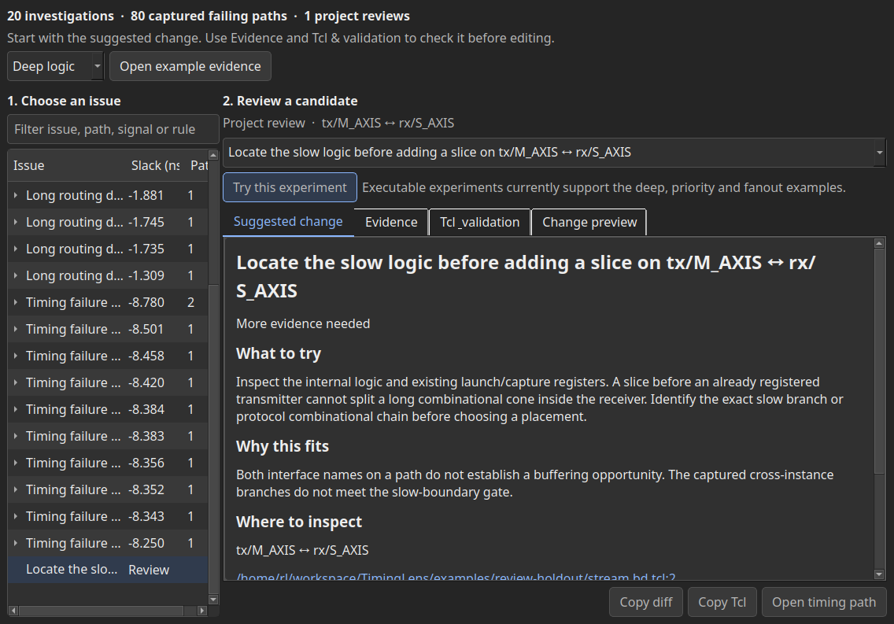
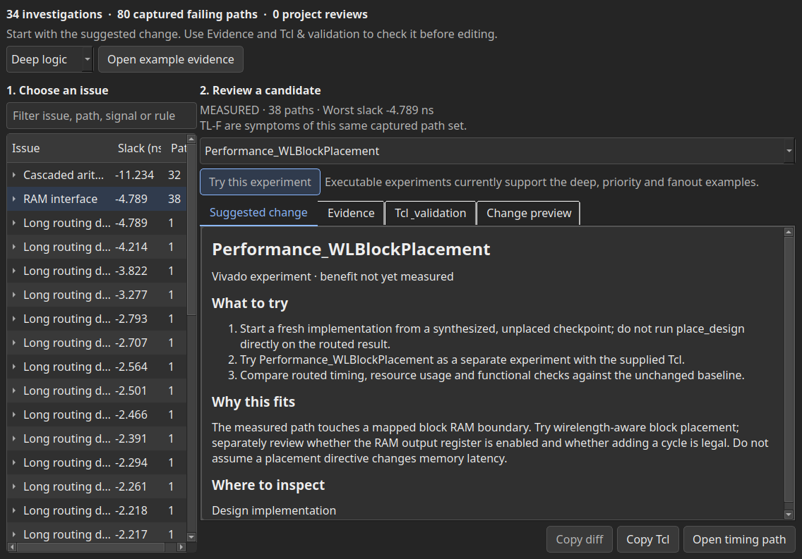

# Timing diagnosis on two held-out designs

These two 2 ns designs test how far the evidence supports a recommendation. Build both with Vivado 2024.2, then review their independent sessions. From the repository root, run the launcher once to prepare the Python environment and choose a new output directory.

```bash
./timinglens.sh --help
.venv/bin/python scripts/build_review_holdout.py --output work/my-heldout
./dashboard.sh work/my-heldout/stream/review/analysis.json
```

## Streaming receiver

The receiver transforms the incoming byte through eight dependent stages before registering it. The producer and receiver expose a streaming boundary, and one control signal propagates backpressure. In **Fix recommendations**, select **Locate the slow logic before adding a slice**. Cross-check the literal link against the measured path. The delay inside the receiver motivates investigating its computation before changing interface latency. This routed build had **−12.370 ns setup** and **+0.100 ns hold**. [Stream RTL](stream.sv) · [Interface declarations](stream.bd.tcl)



## Block RAM feeding a multiplier

Open `work/my-heldout/memory_dsp/review/analysis.json`. The single-clock block reads storage and multiplies the registered data by a coefficient. Under **Fix recommendations**, choose a RAM interface investigation, then **Open timing path** to inspect the cells on that path. Slack was **−11.234 ns setup** and **+0.074 ns hold**. The RAM and DSP evidence supports reviewing placement and the data pipeline. Adding a cycle requires a separate downstream latency contract. [Memory/DSP RTL](memory_dsp.sv)



The recorded experiment evaluated the diagnoses. It did not route a candidate fix. The stream case subsequently informed the boundary rule. [Corpus labels and evaluation scope](../../docs/semantic-review.md#evaluation-corpus)

[All examples](../README.md) · [Illustrated user guide](../../docs/visual-guide.md)
