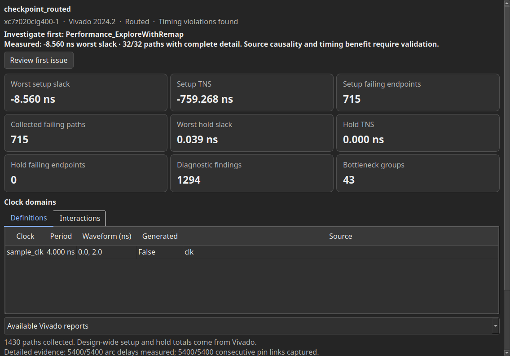
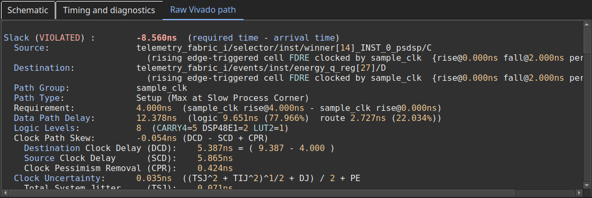
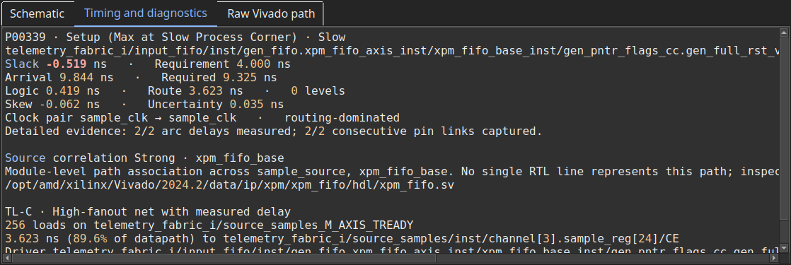

# Eight-channel telemetry block design

This IP Integrator example tests whether TimingLens can distinguish timing failures in a fully routed multi-IP design. It builds the complete programmable-logic top for an xc7z020clg400-1 with a 250 MHz clock, an on-chip traffic source and one registered status output. Everything runs locally in Vivado.

The 25 blocks include a 256-bit AXI4-Stream FIFO with 1,024 entries, a register slice, an unpacker, eight correlation lanes, a priority selector, a dependent arithmetic calculation and an event logger. There are 14 RTL module-reference instances and 11 catalog IP instances. Eight of the catalog instances are word slices. Vivado mapped 42 DSP48E1s, seven RAMB36E1s, one RAMB18E1, 552 slice LUTs and 1,610 slice registers. This example exercises DSPs, memory, streaming and hierarchy on one clock. It uses 1.04% of the device's slice LUTs.

## Trace two different failures

After the [reproduction steps](#reproduce), open `full/analysis.json`. **Overview** counts **715 failing setup endpoints**. The full capture includes a worst setup path for each. Grouping by cause keeps a repeated control signal from looking like hundreds of unrelated design errors.



Open **Show tools and details → Timing paths**. In this run **P00001 → Raw Vivado path** shows the DSP/carry chain in the energy calculation. For **P00339**, **Timing and diagnostics** shows the FIFO ready branch spending **3.623 ns** reaching the producer’s clock enable. An arithmetic pipeline and a backpressure route call for different investigations. Use the endpoint and clock names to find the same class of path after a fresh build.





## Measured results

Vivado 2024.2 fully routed all 4,066 routable nets. At 4 ns, setup WNS was −8.560 ns and TNS was −759.268 ns. Of 5,970 timed setup endpoints, 715 failed. Hold WNS was +0.039 ns with zero failures. All twelve categories in Vivado’s check_timing report had zero affected objects, including missing clocks, unconstrained internal endpoints and missing I/O delays.

| Path in the complete capture | Worst setup slack | What the evidence shows |
| --- | ---: | --- |
| Energy calculation to event register, P00001 | −8.560 ns | TimingLens identified deep logic and cascaded arithmetic in `energy_mix`. Native Vivado shows two DSP48E1s and five CARRY4s. The DSP arcs alone account for 7.864 ns. All 32 energy-register D pins failed. |
| Priority selector to event register, P00034 | −3.995 ns | TimingLens localized the problem to `priority_pick` and identified both routing and fanout. Routing took 6.505 of 8.007 ns. A 65-load LUT output took 2.029 ns to reach the affected sink. The implemented path has five logic levels. The tool did not establish a serial priority-mux chain or offer an exact rewrite. All 32 selected-word D pins failed. |
| Stream slice to frame unpacker, P00066 | −2.483 ns | The unpacker's shared frame control reaches 256 loads. Vivado and TimingLens measured 4.350 ns on the specific branch to bit 252. That one net accounts for 73.1% of the data path. |
| FIFO backpressure to sample generator, P00339 | −0.519 ns | The FIFO's ready signal drives 256 loads in the producer. The measured branch to one channel's clock enable took 3.623 of 4.042 ns. This path was outside the first 100. |
| Local phase-register feedback | +2.210 ns | A separate native query found positive slack and zero failing D pins in this comparison group. |

Vivado renamed the launch register on P00001 under the selector hierarchy during optimization. The measured DSP and carry arcs in the energy block identify the bottleneck more precisely than the launch name alone.

The first capture used the worst 100 paths per check type and one path per endpoint. It found the energy and priority issues and the stream-to-unpacker control path. The second capture raised the limit to 715 per check type. All 715 failing setup paths had complete detail. Their launch pins, endpoint pins and slack matched an independent native Vivado query for every failing setup endpoint. The saved desktop session contains those 715 setup paths and 715 passing hold paths. TimingLens also recovered all 25 BD cells and three declared AXI stream links from the generated BD.

For 708 failing endpoints, at least one rule described a measured timing symptom. Six internal FIFO endpoints and the externally constrained status output received the generic investigation finding. The status output missed its assumed external interface budget by 8.390 ns. The complete capture produced 40 investigations. The first suggested implementation experiment was ExploreWithRemap. This run establishes diagnosis coverage on one design. The effect of that recipe or an RTL pipeline change remains unmeasured.

XSim ran the generated block design with the catalog IP models. Its scoreboard observed 632 input frames and checked 628 ordered output frames before the simulation stopped, with four frames still in flight. It checked all eight lane values and both event calculations on 579 active comparison cycles, including 540 simultaneous selection cases. The native DRC report also records 29 warnings, including DSP pipeline advisories and the absent Zynq PS7 block. The example ends at routed timing analysis.

## Reproduce

Use Vivado 2024.2 and a Python environment with TimingLens installed. Start in the TimingLens checkout. The following commands build in a fresh directory.

```bash
repo=$(pwd)
src="$repo/examples/telemetry-bd"
vivado_bin=${TIMINGLENS_VIVADO:-/opt/amd/xilinx/Vivado/2024.2/bin/vivado}
py="$repo/.venv/bin/python"
mkdir -p "$repo/work"
run=$(mktemp -d "$repo/work/telemetry-bd.XXXXXX")
cd "$run"
"$vivado_bin" -mode batch -notrace -source "$src/build.tcl"
"$vivado_bin" -mode batch -notrace -source "$src/probe.tcl"
"$vivado_bin" -mode batch -notrace -source "$src/census.tcl"
"$vivado_bin" -mode batch -notrace -source "$src/sim.tcl" -tclargs project/telemetry.xpr
export TIMINGLENS_VIVADO="$vivado_bin"
"$py" "$src/analyze.py" "$run" "$run/first"
"$py" "$src/verify.py" "$run" "$run/first"
"$py" "$src/analyze.py" "$run" "$run/full" --max-paths 715
"$py" "$src/verify.py" "$run" "$run/full" --full
```

Open `full/analysis.json` through **Open session** in TimingLens, or open `full/report.html` in a browser. P00001 and P00034 are the two event paths in this archived run. The verifier matches native endpoint names and slack, so path IDs can change on a fresh route. If another implementation changes the number of failures, use its native endpoint count for the full capture.

The [checks declared before routing finished](expectations.md) describe the intended test. The testbench models the correlation, selection and arithmetic independently and compares the transmitted frames with the received frames in order.

[All examples](../README.md) · [Illustrated user guide](../../docs/visual-guide.md)
