# TimingLens tutorial

Start with a routed path that missed setup by **11 picoseconds**. You’ll find the receiving register, trace the delay to its logic and wires, and decide how much the captured RTL can tell you. Then simulate and route a change to the **250 MHz counter** to see whether it meets its 4 ns deadline.

Run the commands from the root of this checkout. The first three lessons work with the files in Git. After the Python dependencies are installed, you can do them offline. The implementation lessons use **Vivado 2024.2** with Zynq-7000 device support. The counter uses **Verilator**, the priority rewrites use **Yosys**, and the arithmetic pipeline proof uses **Yosys and Z3**. All the exercises run on the host computer.

| What you want to do | Lesson |
| --- | --- |
| Open a saved design and trace a failing pin to RTL | [1. Open a path](#1-open-a-path) |
| Bring in reports, source, constraints and design intent | [2. Assemble project evidence](#2-assemble-project-evidence) |
| Read, filter and export a diagnosis or change a rule threshold | [3. Review the diagnosis](#3-review-the-diagnosis) |
| Collect timing from a Vivado project or checkpoint | [4. Capture your own design](#4-capture-your-own-design) |
| Preview, simulate and route an RTL change | [5. Run the counter experiment](#5-run-the-counter-experiment) |
| Inspect, save, export and reopen before/after results | [6. Compare the runs](#6-compare-the-runs) |
| Try a physical fix, sweep implementation strategies or compare RTL structures | [7. Try a recommendation](#7-try-a-recommendation) · [8. Compare alternatives](#8-compare-alternatives) |
| Prove a pipeline edit, apply a verified fix or rebalance scarce resources | [9. Fix a project](#9-fix-a-project) |
| Repeat the workflow in a terminal or use the Python API | [10. Script the analysis](#10-script-the-analysis) |

## 1. Open a path

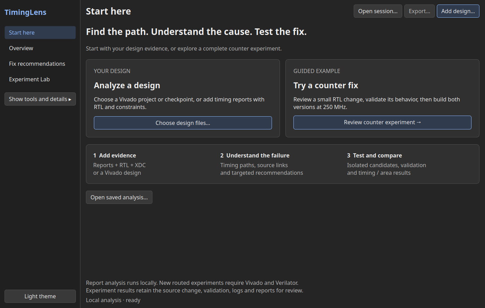

1. On Ubuntu, install Python 3.11 or later and `python3-venv`. Run `./dashboard.sh`. The launcher creates the local Python environment on first use. On **Start here**, choose **Open saved analysis…** and open `tests/fixtures/zybo_dfx_path.json`. The shortcut below opens the same file directly.
2. Select **Overview**. This fixture contains one setup path from a routed Zybo design with a reconfigurable partition (DFX). The full-design setup and hold summaries are absent. Use the captured path for this lesson. Use the whole-core summary in lesson 6 to count failing endpoints.
3. Expand **Show tools and details → Timing paths**. Set **Max slack (ns)** to `0`, type `remaining_reg[10]/CE` in **Search paths**, then select **P00001 → Timing and diagnostics**. You should see **−0.011 ns** slack and **34/34** measured arc delays. The destination is a register’s clock-enable pin. It had to settle before the capture edge even though it carries control rather than data.

```bash
./dashboard.sh tests/fixtures/zybo_dfx_path.json
```

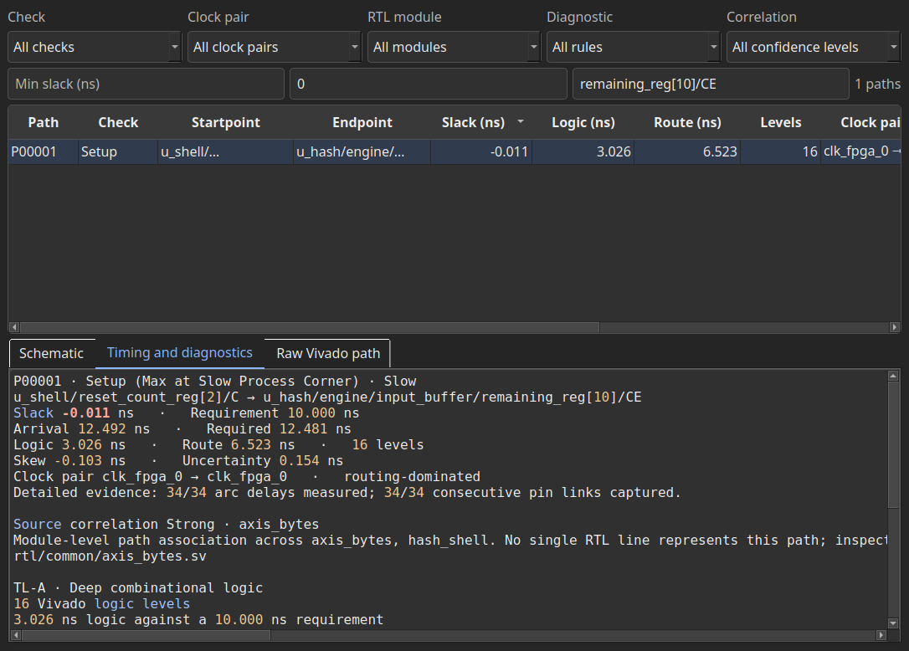

4. Open **Raw Vivado path**. Find the same source and destination, then read the cell and net delays in order. Under **Schematic**, use **Fit** for the whole path, then **Zoom in** or the mouse wheel. Drag the background to pan. Click a net for its branch properties or a cell for its primitive and source association.
5. Choose **Open correlated RTL** for the path, or select a cell and choose **Open cell RTL**. In **Project source**, choose `axis_bytes.sv`, type `remaining` in **Find in source**, and press **Find next**. The line above the editor explains the attribution. Here the path spans two modules. Use the cell you selected and the measured connectivity to decide which expression deserves investigation.

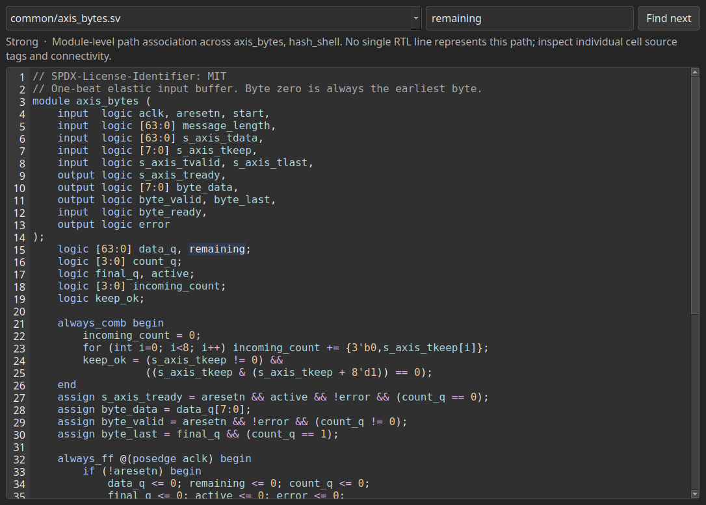

For a larger design, combine the **Check**, **Clock pair**, **RTL module**, **Diagnostic** and **Correlation** filters with a slack range. Click a column heading to sort. Clear the filters to bring back hidden rows. The sidebar theme button switches between light and dark. **Start here → Return to current analysis** reopens the active overview. The launcher saves preferences under `.settings/`.

## 2. Assemble project evidence

**Try a report-only import.** The saved fixture embeds the original Vivado text and HDL. Extract one of each to practice the same workflow you would use with files from a colleague. Run the launcher from lesson 1 first.

```bash
.venv/bin/python - <<'PY'
from pathlib import Path
from timinglens import read_session

sample = read_session(Path("tests/fixtures/zybo_dfx_path.json"))
folder = Path("results/tutorial/input")
folder.mkdir(parents=True, exist_ok=True)
(folder / "setup-paths.rpt").write_text(sample.reports["setup-paths.rpt"])
source = next(s for s in sample.sources if s.path.endswith("/axis_bytes.sv"))
(folder / "axis_bytes.sv").write_text(source.text)
PY
```

1. Choose **Add design…** and select both extracted files. This opens **Project files**. You can also drag files onto the list, add others with **Add files…**, or use **Remove selected**. For this exercise leave **Use the current timing session with these additional files** clear.
2. Select **Analyze selected files** and open **Timing paths**. The report contains the same −0.011 ns path. Its overall build stage and design-wide totals are unavailable from these two files. For your own design, include the corresponding timing summary and specify the optional RTL top when TimingLens needs to reconstruct hierarchy.
3. To supplement an existing session instead, open its `analysis.json`, stage **only the additional files**, and tick **Use the current timing session**. Add RTL, XDC, generated `.bd`, BD/build Tcl and optional intent JSON from the same design revision. TimingLens reads declarations from the supplied files. A changed source digest limits direct RTL attribution. VHDL is available as text context.

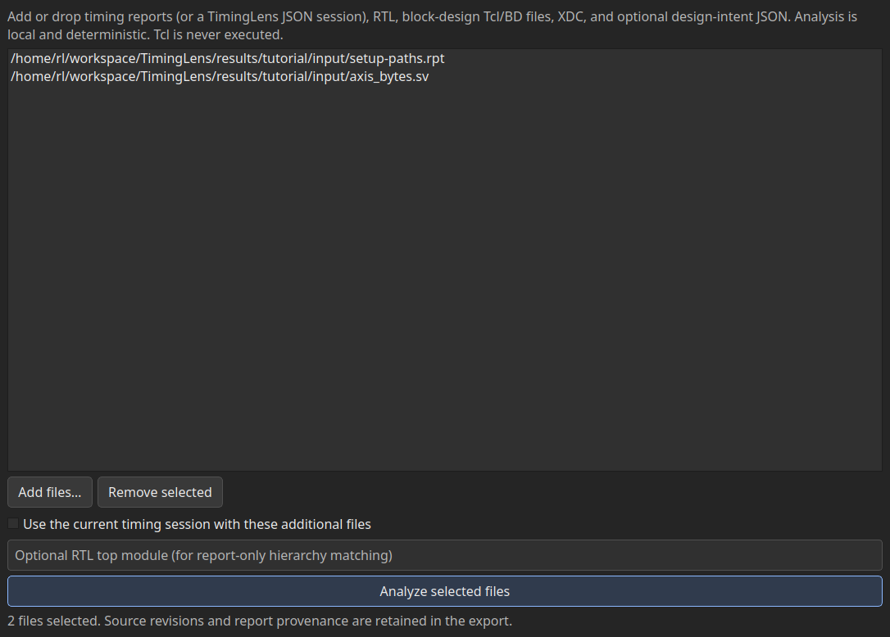

**Try a clock-intent review.** Open the original hash fixture again. On **Project files**, remove the previous inputs, add `examples/project-context/intent.json`, tick **Use the current timing session**, and analyze. Under **Fix recommendations**, select **Review asynchronous clock intent** and open **Evidence**. The template names `sensor_clk` and `fabric_clk`. The capture lacks those clock definitions, so the tool asks for clock evidence. This is the expected outcome of using the unedited template.

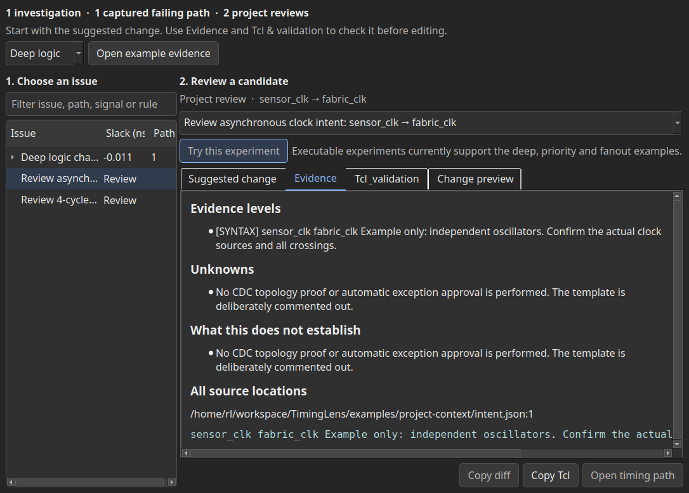

For a real review, edit a copy of the intent file. Use exact clock or pin names and record the functional reason. Supplied XDC exceptions appear under **Audit the supplied timing exceptions**. Open **Tcl & validation** to check selector coverage, ignored exceptions, clock interactions and CDC. For a multicycle path, supply the launch pin, capture pin, cycle count and enable/stability contract. Check both setup and hold edges before using any commented template. DFX work also needs the partition boundaries, static-routing constraints and Vivado compatibility evidence. [Clock and exception prerequisites](docs/project-analysis.md#design-intent-and-timing-exceptions)

For an AXI stream, include its BD interface connections, clock/reset nets and any burst/stall contract. Select the boundary review to see where the measured delay falls. A register slice changes latency and backpressure. A FIFO also changes how many beats can be buffered. In the example below, the declared link has 16 beats of capacity against a possible 256-beat unthrottled burst. The example README includes the exact intent JSON and steps to reproduce this finding. [Stream and FIFO exercise](examples/project-context/README.md)

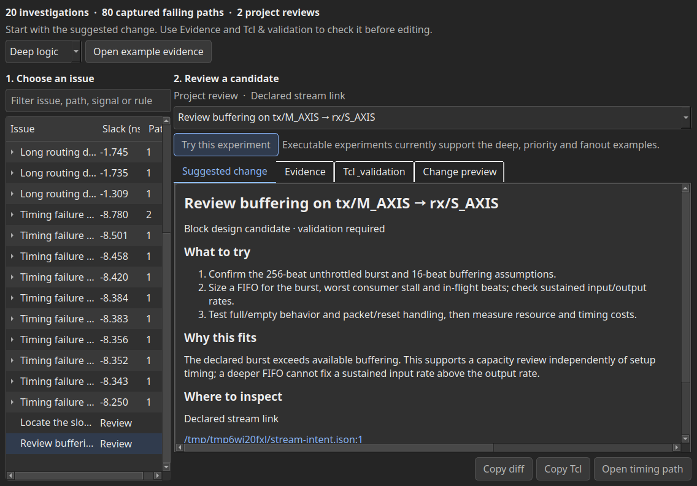

## 3. Review the diagnosis

1. Reopen the hash fixture. Select **Overview → Review first issue**. In **Fix recommendations**, expand the issue in the left tree. Select a path or filter by signal or rule. Related symptoms can describe the same physical path.
2. Choose the comparison-to-enable candidate on the right. **Suggested change** explains the proposal. **Evidence** identifies the measurements, source match and unresolved assumptions. In this example the unsigned comparison is a hypothesis. You can inspect the expression and jump to source without treating it as a verified patch.
3. Open **Tcl & validation** for prerequisites, directives and acceptance checks. **Copy Tcl** places the displayed commands on the clipboard. **Change preview** shows available RTL alternatives. When an exact diff is available, choose an expression and **Copy diff**. **Open timing path** returns to the supporting path.

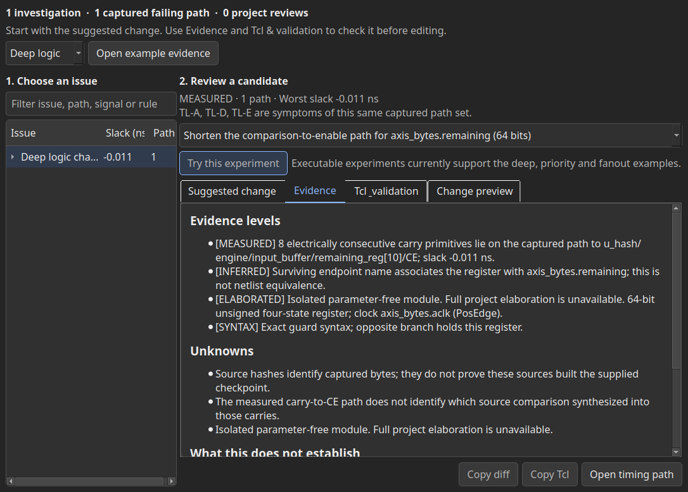

Use these diagnosis families when choosing the next measurement.

| Rule | What to check |
| --- | --- |
| TL-A · deep logic | Count connected levels and check how much of the cycle is spent in logic. Try remapping or redistributing dependent operations. |
| TL-B · priority mux | Trace successive mux data arcs. Confirm which simultaneous request must win before testing an RTL rewrite. |
| TL-C · high fanout | Select the net and inspect the delay to the failing sink. Fanout alone gives no branch delay. |
| TL-D · routing | Compare route and logic delay. Inspect the long branches before trying another physical implementation. |
| TL-E · cascaded arithmetic | Follow carry and DSP arcs and check where the operands are registered. |
| TL-F · RAM interface | Trace the path to or from the memory and review placement, input/output registers and allowed latency. |
| TL-G · clocks and constraints | Check clock definitions, interactions, I/O constraints and exception coverage in the native reports. |
| TL-H · timing violation to investigate | Read the raw path and acquire missing pins, delays or source evidence. Try `tests/fixtures/ambiguous.json` to see an unknown source association. |

For a negative control, the [clean example](examples/clean/README.md) has positive setup and hold slack and zero findings. **Overview → Clock domains → Definitions / Interactions** and the **Available Vivado reports** menu let you cross-check the summary against native evidence. WNS is the worst slack. TNS sums negative slack over failing endpoints. The number of collected failing paths depends on collection limits.

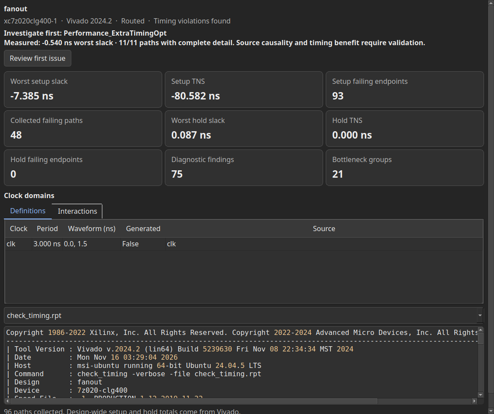

**Export the analysis.** Choose **Export…** in the window header and select a fresh directory. Reopen `analysis.json` in the desktop, inspect `diagnostics.json` for rule findings and source associations, or open `report.html` in a browser and expand a path or recommendation.

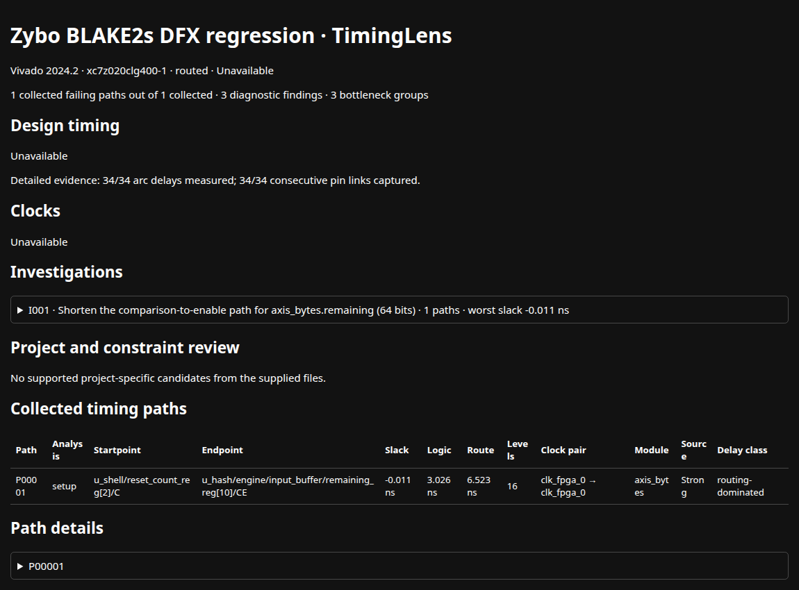

To change rule sensitivity, re-import the same capture with overrides. These affect diagnostic classification. Vivado’s measured slack stays the same.

```bash
./timinglens.sh import --report tests/fixtures/zybo_dfx_path.json --output results/tutorial/hash
printf '%s\n' '{"fanout": 96, "logic_levels": 10}' > results/tutorial/thresholds.json
./timinglens.sh import --report results/tutorial/hash/analysis.json \
  --thresholds results/tutorial/thresholds.json --output results/tutorial/hash-adjusted
```

`--thresholds` also works with `inspect`, `analyze` and `demo`. Use the embedded source for a portable review. On CLI import, `--resolve-local-sources` additionally allows hash-checked reads from paths recorded in the session. [Session fields](docs/session-format.md) · [Rule thresholds](src/timinglens/rules/library.py)

## 4. Capture your own design

1. Run `./timinglens.sh doctor`. It prints the discovered Vivado executable and release, tests the required Tcl commands and checks the device. If discovery selects the wrong installation, use `--vivado /path/to/bin/vivado`, set `TIMINGLENS_VIVADO`, or enter the executable on the **Vivado analysis** page. Offline imports work independently of this toolchain check.

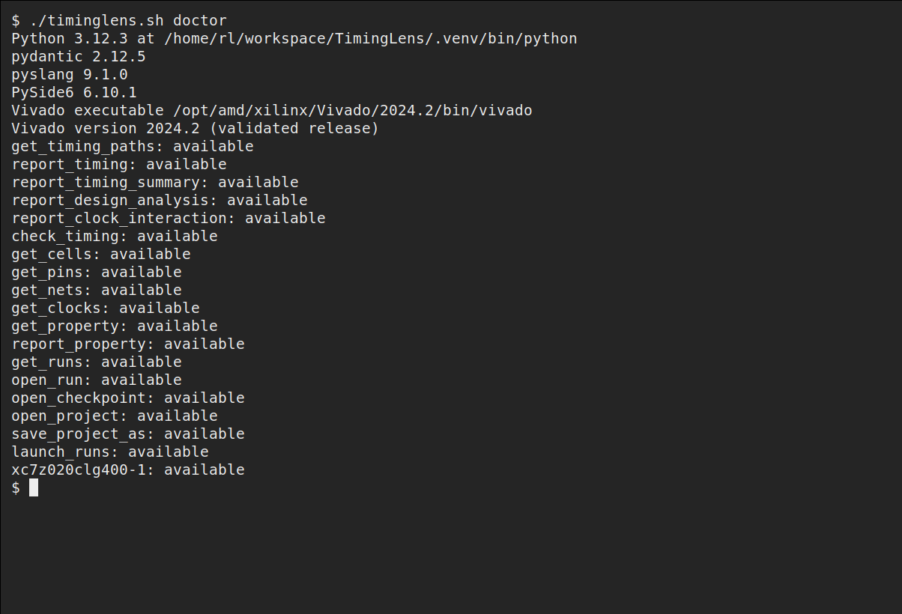

2. Choose **Add design…** and select one `.xpr` project or `.dcp` checkpoint. Set **Output**. For a project choose **Inspect existing design**, or choose an isolated synthesis or route build. If the project already has an implementation, enter its run name to select it explicitly. With the run field empty, TimingLens prefers the completed current implementation, then the completed current synthesis run. A checkpoint opens at its saved stage.
3. Set **Paths per analysis** and **Paths per endpoint** to widen or narrow collection. Add matching RTL, Tcl, XDC or BD context with **Select RTL, Tcl, XDC or BD context**. Clear **Include RTL snapshots** to omit source text from the exported session. Choose **Run analysis**. Read the log on this page or use **Cancel** during the job.
4. On **Overview**, check the device, stage, clocks, setup and hold totals. Synthesis routing delays are estimates. Use routed evidence when judging a physical fix. The output folder contains the session, diagnostics, HTML and a Vivado work directory with native reports and logs.

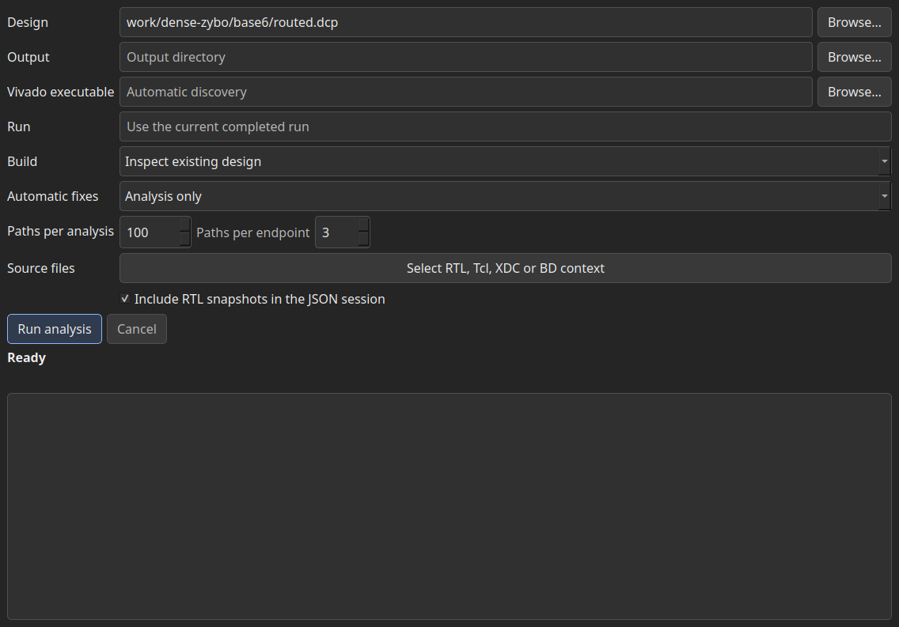

To inspect a named run from the shell, replace the project path below with your XPR. To build a fresh isolated implementation, use `--build route` in place of `--run impl_1`.

```bash
./timinglens.sh analyze --project /path/to/design.xpr --run impl_1 --output results/tutorial/my-design
```

For the four small bundled designs, this command builds the evidence used by the desktop example picker. Run it when the corresponding `results/verified/<design>/analysis.json` files are absent. To build a single design use `--design clean`, `deep`, `fanout` or `priority` and point `--output` at its specific directory.

```bash
./timinglens.sh demo --run-vivado --max-paths 48 --output results/verified
```

## 5. Run the counter experiment

1. Open **Start here → Review counter experiment**. Under **RTL change**, compare `remaining >= amount` with the replacement. The request fits in four bits. If any upper count bit is set, every possible request fits. Otherwise the low four bits determine whether subtraction is allowed, including equality.
2. Open **Validation and recipe**. Verify the 4 ns clock and the common Default implementation recipe. **Advanced settings** lets you choose the Vivado executable, results parent and per-tool timeout. The GUI makes a new timestamped job inside that parent.

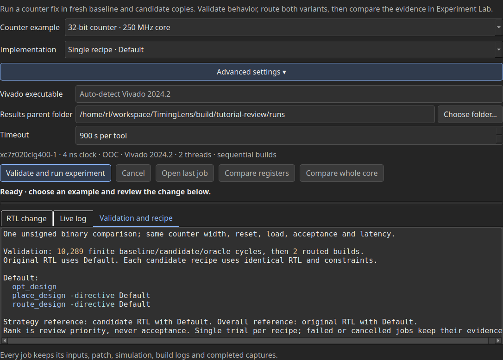

3. Select **Validate and run experiment**. **Live log** shows tool checks, simulation, baseline and candidate implementation, and comparison. The simulation checks both versions against an independent behavioral oracle. **Cancel** stops the current experiment and retains completed evidence. To retry, start a fresh job. **Open last job** reloads the saved evidence.
4. When **Experiment Lab** opens, check the **whole-core** setup and hold results. The 250 MHz run clears **32 failing setup endpoints**, changes WNS from **−0.633 to +0.407 ns**, and uses **41 physical LUTs** in place of 50. The result covers this standalone core. Its system-level integration remains a separate check.

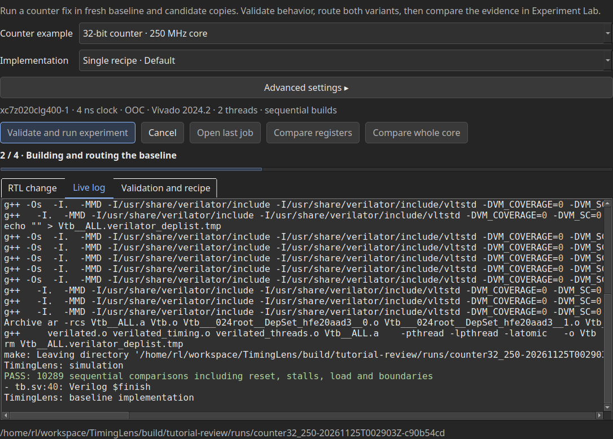

To select another profile, expand **Show tools and details → Counter experiment**. The 32-bit 2 ns stress profile retains `>=`. The 64-bit 2 ns profile uses a strict `>`, so equality must hold the count. Use **Compare registers** and **Compare whole core** to examine the two populations. **Experiment Lab → Run counter…** also opens the runner. [Counter profiles and run directories](docs/counter-runner.md)

## 6. Compare the runs

Use the pair opened by the runner, or choose **Experiment Lab → Import runs…**. In a completed counter job, select `runs/baseline.design.run.json` and `runs/candidate.design.run.json`. Set the baseline and candidate selectors, then click **Compare**. Use the arrow between the selectors to reverse the comparison. **Restore history** reloads previously imported files. **Load example** opens a retained counter or DFX pair when its local catalog is installed. You can also compare two native `analysis.json` files, with fewer build and validation details.

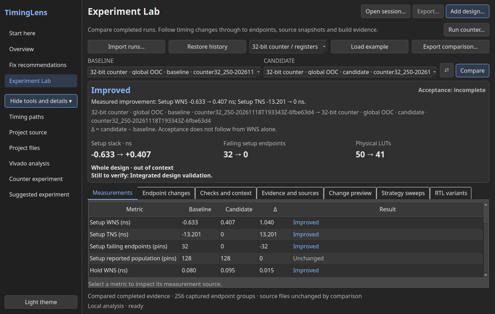

| Tab | Do this |
| --- | --- |
| **Measurements** | Select a row to see its measurement source. Check setup and hold WNS/TNS, failing counts, pulse width, routing, DRC and area. Keep both records on the same population. |
| **Endpoint changes** | Search for a pin or clock, then filter **Regressions**, **Newly failing**, or **Unmatched / ambiguous**. Select a row. Use **Inspect baseline path** or **Inspect candidate path** to open its embedded graph and source. |
| **Checks and context** | Select **Acceptance checks** to see pass, failure or untested scope. Switch to **Comparison context** and inspect device, tool version, clock and implementation differences. |
| **Evidence and sources** | Choose baseline or candidate, then select a report, source snapshot or validation record. Compare the displayed value with its native evidence. |
| **Change preview** | Read the exact change recorded with the candidate. For a physical experiment, this can be a Tcl recipe diff. |

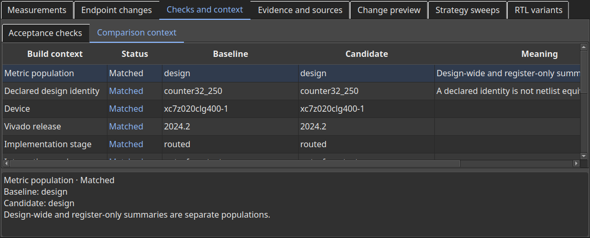

Read the outcome and acceptance separately. **Improved**, **regressed** or **unchanged** describe measured differences. **Inconclusive** calls for checking context or compatibility. **Blocked** points to a failed gate or regression, **incomplete** identifies missing evidence, and **review ready** means the supplied checks passed for the stated scope. Missing measurements appear as **Not supplied** or **Not tested**.

Return to **Counter experiment** and choose **Compare registers** for the completed 250 MHz run. Repeat with **Compare whole core**. Both show 32 failing setup endpoints falling to zero. Among register-to-register paths, worst hold slack fell from +0.295 to +0.294 ns. The regression guard flags that 1 ps loss even though hold still passes. Across the whole core, worst hold slack rose from +0.080 to +0.095 ns. Check which paths a comparison covers before interpreting its verdict.

The 64-bit stress run illustrates why the endpoint view matters. The register WNS improved from −3.030 to −2.043 ns, yet failures rose from 126 to 128. The **Newly failing** rows identify the two data pins. Matching uses the check, endpoint and clocks. A path present on only one side can also reflect capture limits.

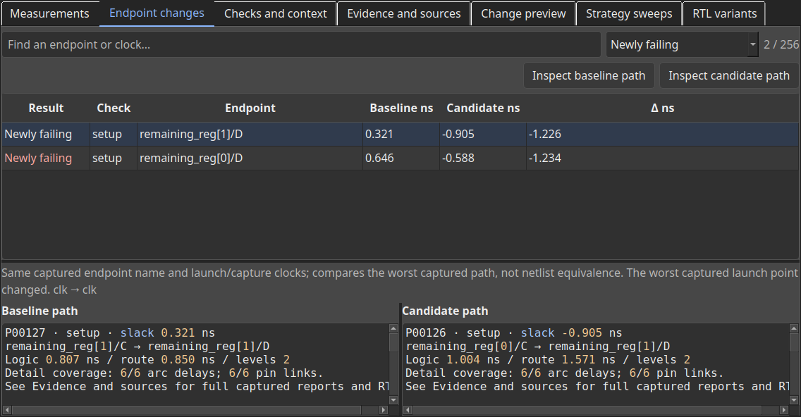

Under **Evidence and sources**, choose **Candidate evidence** and open `Report / utilization.rpt`. Check that the native report names the routed candidate and the expected device before reading the LUT counts.

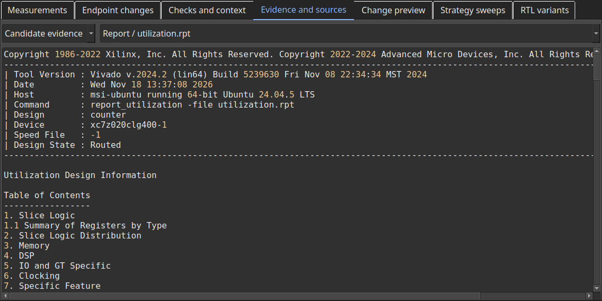

In the 250 MHz run, inspect **Change preview**, then **Checks and context → Integrated design validation**. The result distinguishes a successful standalone route from the evidence still required for the complete FPGA design.

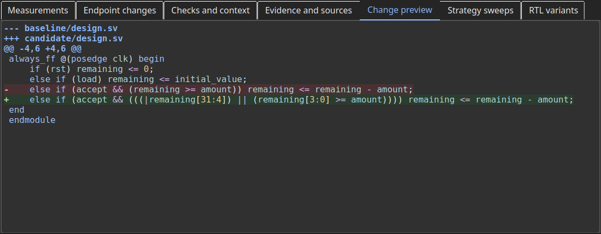

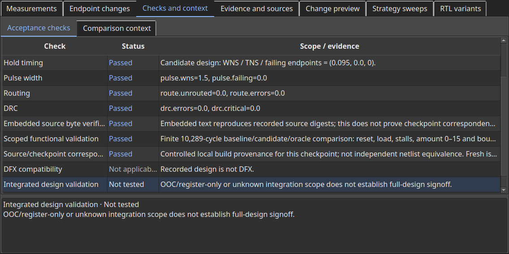

Choose **Export comparison…** and select a parent directory. Open `timinglens-comparison-01/report.html` in a browser (the number advances for later exports). Give another reviewer that folder to read the HTML or reimport both `.run.json` records. The `comparison.json` file holds the machine-readable result. [Experiment Lab evidence and verdicts](docs/experiment-lab.md)

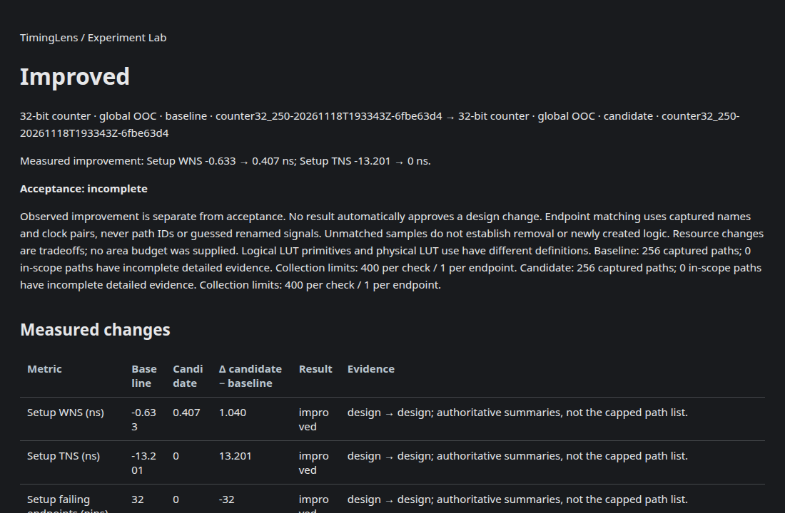

## 7. Try a recommendation

1. Generate the small design sessions in [lesson 4](#4-capture-your-own-design). In **Fix recommendations**, choose **High fanout → Open example evidence**. Select the slow high-fanout investigation and the **AggressiveFanoutOpt** candidate. The issue’s **Tcl & validation** tab shows the required checkpoint stage, proposed commands and success checks.
2. Choose **Open timing path** for a branch or find `lane[107].active_reg/CE` in **Timing paths**. Select the `control_q` net in the schematic. It drives 192 loads. Vivado measured **2.404 ns** on this branch of a **2.882 ns** datapath. That branch measurement explains why a physical optimization is worth testing.
3. Return to the recommendation and choose **Try this experiment**. In **Suggested experiment → Experiment preview**, review the pinned example, clock, baseline and candidate recipes. Set the results parent, tool paths and timeout as needed, then **Run isolated experiment**. The runner checks the simulation and the fresh baseline before trying the candidate. Use **Live log**, **Cancel** and **Open last job** as in the counter runner.
4. Inspect the register comparison in the Lab, then choose **Compare design** in the runner to check the full example. In the recorded experiment the register WNS worsened from **−0.664 to −0.759 ns**. This is a reason to keep the baseline. [Fanout walkthrough](examples/fanout/README.md)

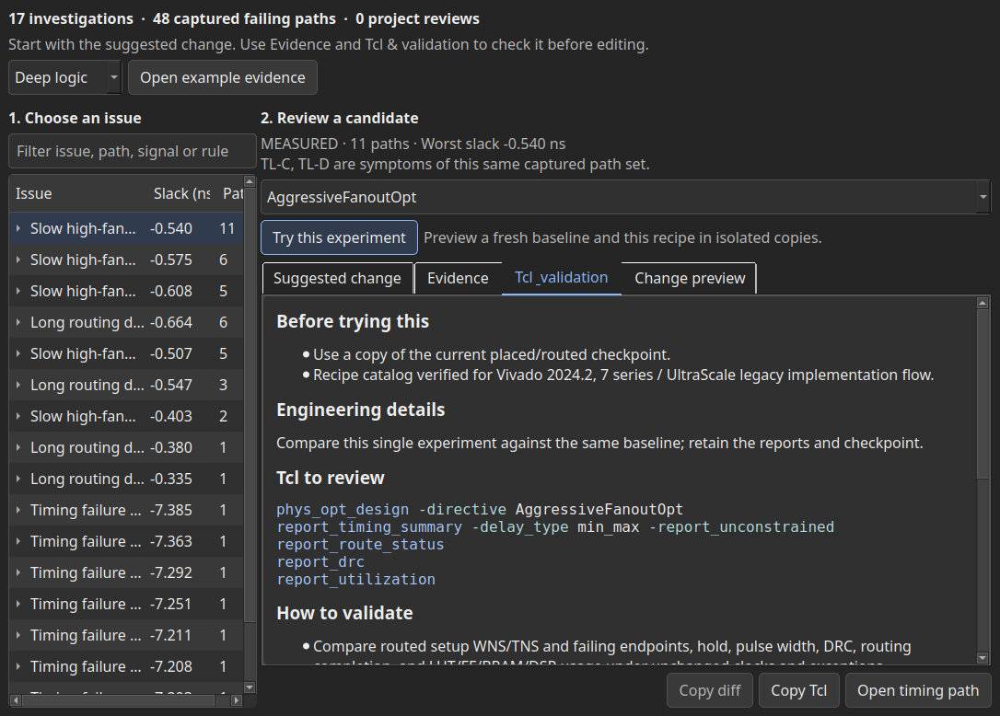

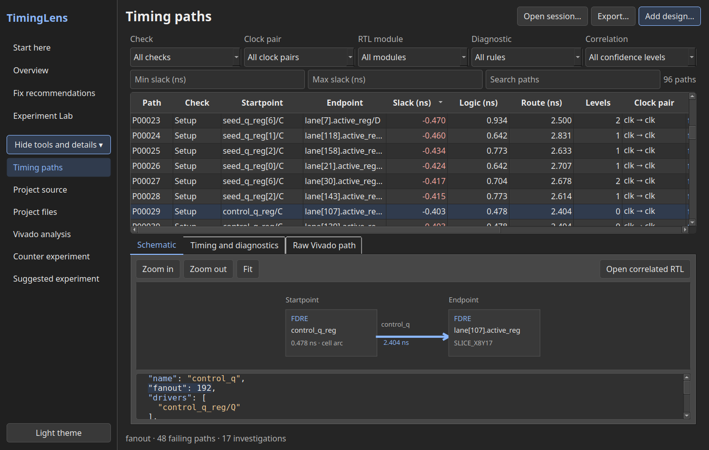

The same workflow supports **Deep logic → Performance_ExploreWithRemap** and the eligible **Performance_ExtraTimingOpt** implementation candidate. Select **Priority mux → Balanced priority tree · RTL rewrite** to test a single RTL rewrite with the same physical recipe on each side. Yosys checks the binary priority behavior before routing. A disabled **Try this experiment** means the selected evidence can guide review, but the runner lacks a supported recipe for that input. [Deep-logic walkthrough](examples/deep/README.md) · [Single priority rewrite](docs/priority-rewrite.md)

## 8. Compare alternatives

**Change the Vivado recipe.** In **Counter experiment**, choose **64-bit unsigned counter · >** and **Strategy sweep · 3 recipes**, then **Validate and run experiment**. **Experiment Lab → Strategy sweeps** ranks Default, Performance_Explore and Performance_ExtraTimingOpt. Select a row, then use **Compare recipe to Default** to hold candidate RTL fixed. **Compare to original RTL** includes the effect of both the rewrite and the recipe. Switch **Register paths** to **Global OOC** to check whole-core hold and I/O. Failed or incomplete recipes retain their evidence and have no rank.

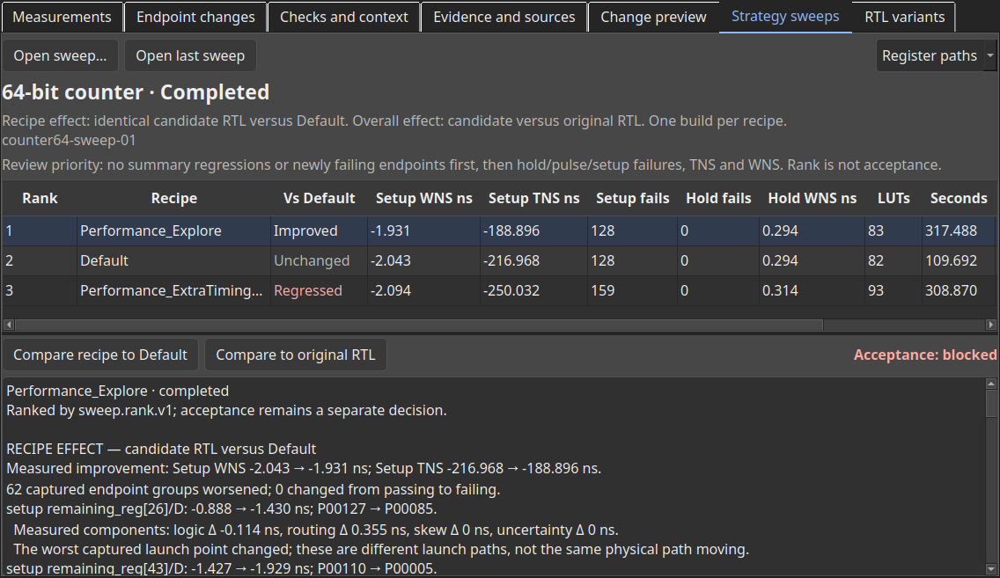

**Change the RTL structure.** Under **Fix recommendations**, choose **Priority mux → Open example evidence → Verified RTL variants · 3 candidates → Try this experiment**. In **Source diff**, use the selector to inspect the balanced tree, grouped selection and priority mask. All three must preserve the highest asserted request as the winner. Run the experiment to check each candidate’s equivalence, simulate it, and route it with Default against one shared baseline.

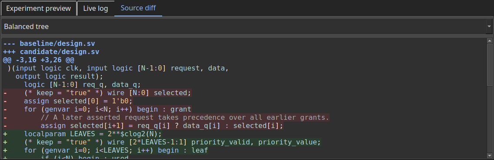

In **Experiment Lab → RTL variants**, click a point on the plot or its table row. Try a **24 LUT** review limit. In the recorded register comparison, grouped selection used 24 logical LUTs at −1.651 ns. The mask improved slack to −1.336 ns and used 26. The limit changes the review flag. The points and measured timing/area frontier stay in place. Switch to **Full example**, then **Inspect selected comparison** to check hold, newly failing endpoints and proof evidence.

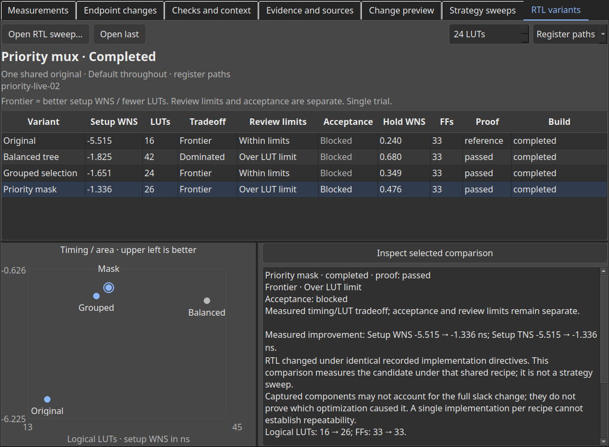

For either sweep, **Export sweep…** writes the run records, manifest and HTML together. Use **Open sweep…** with `sweep.json` for a strategy sweep or **Open RTL sweep…** with `rtl-sweep.json` for priority variants. Keep the adjacent records with the manifest. **Open last sweep** and **Open last** restore the respective previous selections. [Strategy ranking](docs/strategy-sweeps.md) · [RTL tradeoff policy](docs/rtl-variant-sweeps.md)

## 9. Fix a project

### Test and apply a supported fix

Create the original I/Q power project with Vivado on your path. The first command generates the project, and the second runs a project-copy experiment from the shell. To use the desktop instead, stop after creating the XPR and follow the steps below.

```bash
vivado -mode batch -source examples/dense-suite/create.tcl -tclargs \
  "$PWD/examples/dense-suite" iq_power "$PWD/work/tutorial/iq_power"
./timinglens.sh auto-fix --project work/tutorial/iq_power/iq_power.xpr \
  --output results/tutorial/iq-fix
```

In **Add design…**, select a self-contained static `.xpr`. Under **Automatic fixes**, choose **Apply verified fixes in a project copy**, then **Run and apply verified fixes**. TimingLens routes a fresh baseline, validates the supported edit, routes the candidate with the same constraints, and records its decision. Open **Experiment Lab** for the comparison. The job’s `decision.json` gives the disposition and candidate location.

For an in-place change, explicitly select **Update the selected project after verification**. A successful publication retains originals in the job’s `original/` directory. For a supported IP change, the tool updates the BD and its linked IP configuration together. If the candidate needs review, inspect the job evidence and reason before deciding what to change.

Besides RTL pipelines, the tool handles supported Vivado Multiplier Generator configurations. At **Fix recommendations → Run from project…**, select the corresponding XPR to test the mapping. In the [pixel-gain example](examples/dense-suite/pixel_gain/README.md), changing LUT multipliers to DSP blocks preserves the one-cycle interface. The new design closes setup and still has DSP pipeline advisories worth reviewing.

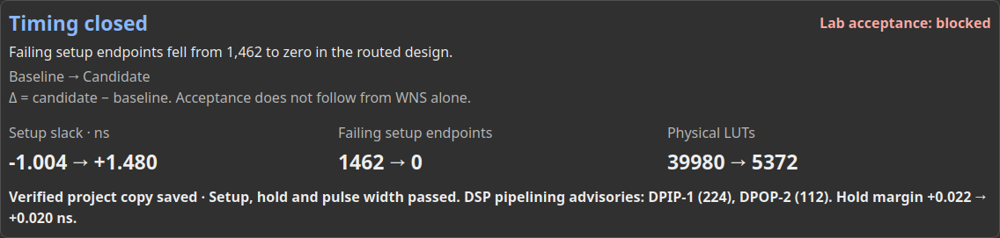

### Prove an arithmetic pipeline edit

1. In the I/Q job you just built, open `baseline/analysis/analysis.json` in TimingLens. This is the measured original design. You can also follow the [four-cycle calibration example](examples/dense-zybo/README.md#reproduce) and open its original routed session.
2. In **Fix recommendations**, select the **DSP pipeline** investigation, then **Change preview**. In the I/Q example, two squares, a sum and a weighted product originally precede the first register. Trace each sample’s weight alongside its data in the proposed four-cycle implementation.
3. Choose **Verify RTL fix…** and an output parent. TimingLens stages the change, runs Yosys and Z3, and reports whether the leaf outputs agree on the same cycle after pipeline fill. Read `candidate.sv`, `candidate.patch` and `proof.json` in the result folder. The proof covers arbitrary binary input sequences within the supported leaf. Simulate the assembled design and route it at the original clock to test integration and physical timing.

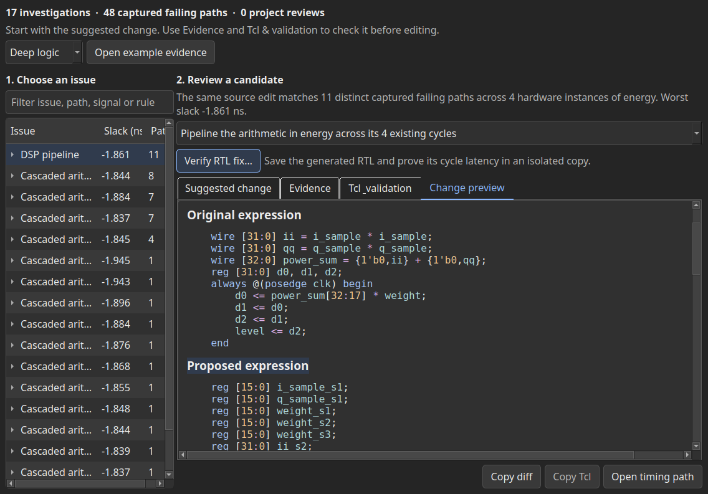

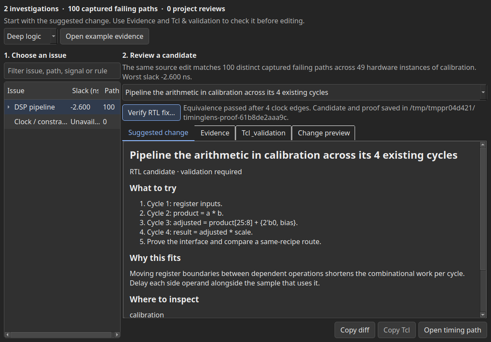

### Rebalance resources on a design that already meets timing

Generate the shallow-memory project below. Open `work/tutorial/memory/banks.xpr`, select project-copy mode, enable **Rebalance overused resources**, set **Utilization limit** to **85%** and run. The screenshot shows the same controls at **65%** for the separate fabric-multiplier workload.

```bash
vivado -mode batch -source examples/resource-balance/create.tcl \
  -tclargs "$PWD/work/tutorial/memory" memory
```

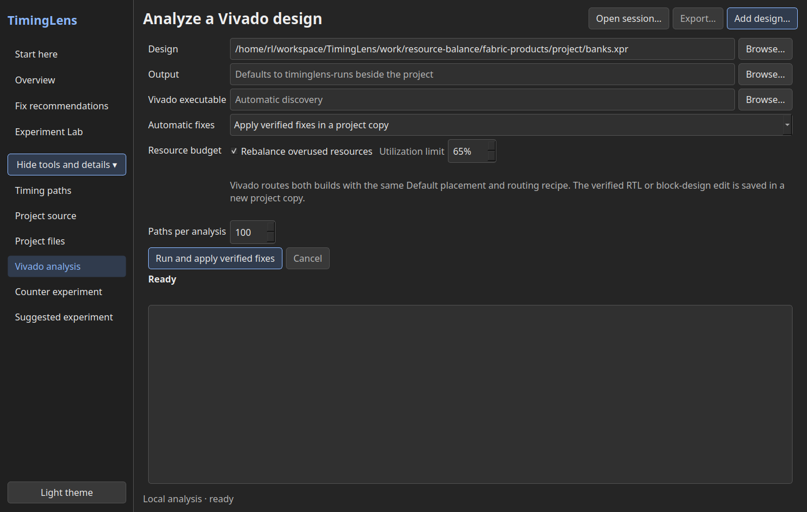

In the shallow-memory run, block RAM use fell from **140 tiles to zero** and memory-capable LUT use rose from **160 to 2,400**. Check both pools, the RAM behavior check, routed timing and DRC. The reverse mapping is available for deeper distributed RAM. Supported multipliers can also move in either direction between DSPs and LUT logic. A baseline that fails placement has no routed baseline slack for comparison. [All seven capacity workloads](examples/resource-balance/README.md) · [Publication criteria and backups](docs/automatic-fixes.md)

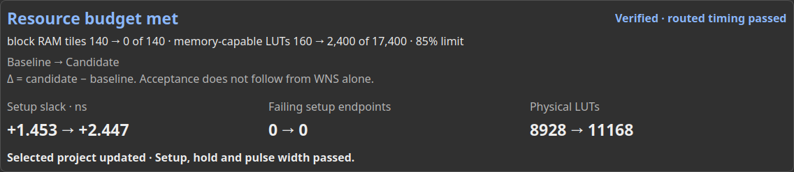

## 10. Script the analysis

Use the task commands below in place of the matching GUI operations. Paths in this table follow the lessons above. A GUI counter job uses a timestamped directory. The `experiment` command below gives the CLI job the fixed name `results/tutorial/timer`. Choose another output name for a second run. Use `./timinglens.sh COMMAND --help` for the full option list.

| Feature | Command from the checkout |
| --- | --- |
| Tool and device check | `./timinglens.sh doctor` |
| Launch the desktop on a saved session | `./timinglens.sh gui tests/fixtures/zybo_dfx_path.json` |
| Reopen an analysis or export JSON and HTML | `./timinglens.sh import --report tests/fixtures/zybo_dfx_path.json --output results/tutorial/hash-copy` |
| Analyze text reports with source context | `./timinglens.sh inspect --files results/tutorial/input/setup-paths.rpt results/tutorial/input/axis_bytes.sv --output results/tutorial/report-review` |
| Route a bundled design | `./timinglens.sh demo --run-vivado --design deep --max-paths 48 --output results/tutorial/deep` |
| Preview a counter edit or run it | `./timinglens.sh experiment --example counter32_250 --preview`, then `./timinglens.sh experiment --example counter32_250 --output results/tutorial/timer`. Add `--sweep` to run all three recipes. |
| Inspect a checkpoint from that run | `./timinglens.sh analyze --checkpoint results/tutorial/timer/baseline/routed.dcp --source results/tutorial/timer/baseline/design.sv --output results/tutorial/timer-capture` |
| Preview or run a recommendation | `./timinglens.sh try-experiment --session results/tutorial/deep/analysis.json --plan vivado.remap --preview`. Replace `--preview` with `--output results/tutorial/remap` to run it. Other plan IDs are `vivado.fanout`, `vivado.extra_timing`, `rtl.priority_balanced` and `rtl.priority_sweep`, each requiring matching evidence. |
| Prove the I/Q leaf from lesson 9 | `./timinglens.sh verify-fix --session results/tutorial/iq-fix/baseline/analysis/analysis.json --module energy --output results/tutorial/iq-proof`. Add `--routed-pair BASELINE_RUN CANDIDATE_RUN` to assess the exact proven edit against a completed whole-design pair. |
| Apply a supported change in a project copy | `./timinglens.sh auto-fix --project work/tutorial/iq_power/iq_power.xpr --output results/tutorial/iq-fix`. Add `--apply-to-source` when you intend an in-place update after verification. |
| Rebalance the memory project | `./timinglens.sh auto-fix --project work/tutorial/memory/banks.xpr --resource-limit 85 --output results/tutorial/memory-fix` |
| Export a completed comparison | `./timinglens.sh compare --baseline results/tutorial/timer/runs/baseline.design.run.json --candidate results/tutorial/timer/runs/candidate.design.run.json --output results/tutorial/timer-comparison` |

On collection, use `--run` for a named XPR run, `--build synth` or `--build route` for an isolated build, and repeat `--source` (alias `--file`) for context. Use `--max-paths` and `--paths-per-endpoint` to control collection depth or `--no-source-text` to omit snapshots. The experiment runners accept `--timeout`, `--vivado` and `--verilator`. Priority proof also accepts `--yosys`. Pipeline proof accepts `--yosys` and `--z3-library`. A completed build can still yield a timing regression. Read the Lab outcome and acceptance checks alongside the process status.

**Use Python to answer a specific question.** After exporting the hash session in lesson 3, start `.venv/bin/python` in the repository root and run the following. Which rules describe the one captured endpoint? The output shows TL-A, TL-D and TL-E, each with the same −0.011 ns slack. These are three observations about one path.

```python
from pathlib import Path
from timinglens import analyze, read_session

s = read_session(Path("results/tutorial/hash/analysis.json"))
r = analyze(s)
print([(p.id, p.analysis, p.slack_ns) for p in s.paths])
print([(g.rule, g.worst_slack_ns) for g in r.groups])
print(r.paths["P00001"].reason)
```

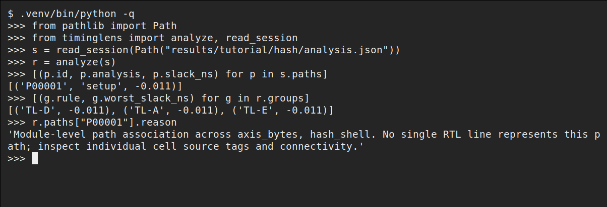

For custom scripts, pass a `Thresholds` object to `analyze`, inspect `r.findings`, `r.groups` and `r.investigations`, or save a `Session` using `write_session(path, session)`. [Python API](src/timinglens/__init__.py) · [CLI reference and installation options](docs/usage.md) · [Illustrated desktop reference](docs/visual-guide.md) · [All example walkthroughs](examples/README.md)
